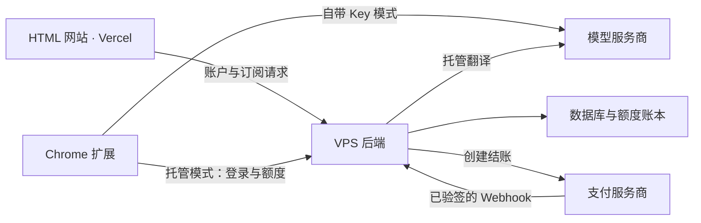

# 工程结构与部署边界

## 三个应用

| 应用 | 负责什么 | 发布什么 |
| --- | --- | --- |
| `apps/web` | 宣传、语言页面；后续前台账户与订阅页面 | Vercel 静态 HTML、CSS、JS 与资源 |
| `apps/backend` | 身份、试用额度、托管翻译、支付订阅、后台管理界面与数据 | VPS 服务、管理界面与数据库迁移；目前尚未实现 |
| `apps/extension` | Chrome 内的划词、区域、图片、文字面板与视频字幕交互 | Chrome 商店扩展 ZIP |

扩展中的 `src/manage` 是现有“区域翻译规则管理”界面，属于扩展本身，不是收费后台管理系统。

网站目前启用 11 种语言，扩展支持 24 种语言；两套目录独立维护，发布和翻译更新互不依赖。当前源码中没有注册、订阅、试用额度或托管服务。

## 后续服务关系

此图描述后续收费功能的边界；当前可用的翻译链路仍是扩展直接调用用户选择的服务商。

## 旧目录到新目录

| 原路径 | 当前路径 |
| --- | --- |
| `manifest.json`、`src/`、`icons/`、`_locales/` | `apps/extension/` 下相同路径 |
| `extension-i18n/` | `apps/extension/i18n/` |
| `scripts/` | `apps/extension/scripts/` |
| `store-assets/` | `apps/extension/store-assets/` |
| `docs/` 的网站内容 | `apps/web/public/` |
| `i18n/` | `apps/web/i18n/` |
| `test/csp.mjs`、`test/i18n.mjs`、`test/lang.mjs` | `apps/web/test/` |
| 其余扩展测试 | `apps/extension/test/` |
| `VIDEO-AUDIO-TRANSLATION.md` | `docs/extension/video-audio-translation.md` |

根目录 `test/run.sh`、`package.sh` 保留为统一入口。`LICENSE` 与已有公开链接使用的 `PRIVACY.md` 保留在根目录。`.vercel/`、`.env.local` 与忽略的本地工具不迁入应用发布目录。

## 发布和配置

- Vercel 项目仍使用**仓库根目录**作为 Root Directory。根目录 `vercel.json` 指向 `apps/web/public`，网站访问 URL 保持原样。
- 网站 CI 检查网站多语言、覆盖范围和 CSP，网站相关改动才触发部署。后端后续建立单独的 VPS 发布流程。
- 扩展打包进入临时目录，拷入运行文件及统一 `LICENSE`，产物生成到 `dist/extension/`。不包含网站、后端、环境文件、开发脚本、测试或商店素材。
- 开发期翻译 Key 可继续放在根目录 `.env.local`；扩展生成器优先读取应用自己的 `.env.local`。文件不随发布产物分发，也不执行其中的代码。
- 服务端新增密钥与数据库连接配置应放在 VPS 环境中。浏览器侧只接收需要公开的 API 地址与 OAuth 公共标识。

## 本地迁移

在 `chrome://extensions/` 中加载 **`apps/extension`**。移动已解压扩展的目录可能改变开发版 ID；原扩展的数据属于原 ID，新的开发版可能需要重新填写 Key 和偏好。此目录调整不改变既有 Chrome 商店条目。

本地静态预览的文档根目录为 `apps/web/public`。内部页面路径、图片与脚本 URL 均保持不变。

本次整理先让三个应用各自拥有源码、开发工具、测试与说明。只有出现实际共用的数据结构或接口后，再添加共享包；目前不为后端预装框架或人为拆出第四个应用。
