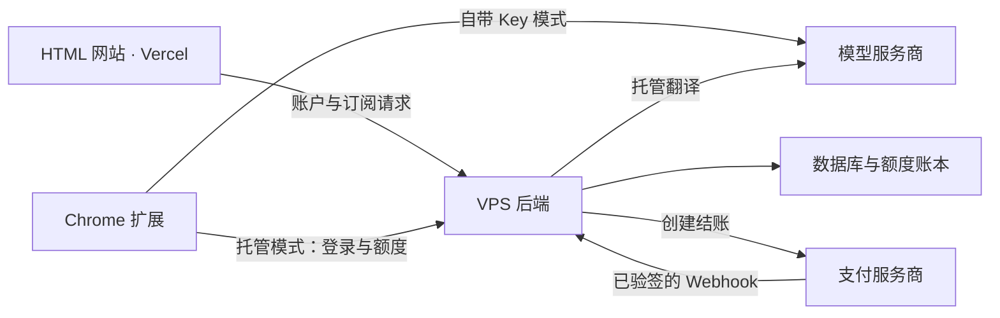

# 工程结构与部署边界

## 三个应用

| 应用 | 负责什么 | 发布什么 |
| --- | --- | --- |
| `apps/web` | 宣传、语言页面；后续登录入口和登录状态展示 | Vercel 静态 HTML、CSS、JS 与资源 |
| `apps/backend` | 身份、试用额度、托管翻译、支付订阅、完整账户和管理页面与数据 | VPS 服务、页面与数据库迁移；目前尚未实现 |
| `apps/extension` | Chrome 内翻译；优先实现登录、点数、订阅和托管模式入口 | Chrome 商店扩展 ZIP |

扩展中的 `src/manage` 是现有“区域翻译规则管理”界面，属于扩展本身，不是收费后台管理系统。

网站目前启用 11 种语言，扩展支持 24 种语言；两套目录独立维护，发布和翻译更新互不依赖。当前源码中没有注册、订阅、试用额度或托管服务。

## 后续服务关系

此图描述后续收费功能的边界；当前可用的翻译链路仍是扩展直接调用用户选择的服务商。

## 网页与扩展的统一账号（规划）

扩展是收费功能的主要使用入口。它需要登录与退出、用户名与必要的账号状态、试用及剩余点数、套餐及订阅状态、托管与自带 Key 模式选择、订阅升级及管理入口。账号资料只保留必要的 email 和 username，第三方头像、昵称、真实姓名等额外资料不保存或展示。余额与权益以 VPS API 为准；点数用尽后后端拒绝托管请求，自带 Key 模式继续按用户配置运行。

建议的域名划分如下，尚未配置 DNS 或服务：

| 域名 | 部署位置 | 用途 |
| --- | --- | --- |
| `huaci.app` | Vercel | 官网、登录入口、登录状态及简要权益展示 |
| `app.huaci.app` | VPS | 用户管理界面：注册、登录、账户、订阅与账单 |
| `admin.huaci.app` | VPS | 独立管理员界面；管理接口由服务端验证管理员权限 |
| `api.huaci.app` | VPS | 两端共用的认证、用户、额度、翻译及支付 API |

`app`、`admin` 和 `api` 可以由同一台 VPS 和同一个 `apps/backend` 应用提供服务。两套界面的基础功能见 [功能审核稿](backend/ui-scope.md)。

网页使用 HTTPS 与后端 HttpOnly、Secure Cookie 会话；调用跨子域 API 时携带 credentials。Cookie 可只绑定 API 主机，官网通过状态接口读取用户名、登录状态和必要的点数与订阅权益，无需 JavaScript 读取登录 Cookie。跨子域仍是跨来源请求，需要服务端 CORS 来源白名单，修改状态的请求还需 CSRF 防护；网站 CSP 需允许具体 API 来源。

扩展使用 `chrome.identity.launchWebAuthFlow` 发起用户主动登录，身份验证在 VPS 完成，经 Chrome 的扩展回调返回一次性授权码，再用 PKCE 校验交换短期会话令牌。会话支持刷新与撤销，令牌不放入回调 URL 或宿主网页。后台 API 调用由 service worker 发起，manifest 在接入时加入 `identity` 权限和 API 主机权限。

网页与扩展登录凭据分别管理，使用同一后台用户 ID、点数账本和订阅权益；Chrome 账号或浏览器同步状态不能代替本产品的登录验证。当前尚未实现以上账号功能。

参考：[Chrome 登录 API](https://developer.chrome.com/docs/extensions/reference/api/identity)、[扩展跨域请求](https://developer.chrome.com/docs/extensions/develop/concepts/network-requests)、[网页携带会话凭据](https://developer.mozilla.org/en-US/docs/Web/API/Fetch_API/Using_Fetch#including_credentials)。

## 旧目录到新目录

| 原路径 | 当前路径 |
| --- | --- |
| `manifest.json`、`src/`、`icons/`、`_locales/` | `apps/extension/` 下相同路径 |
| `extension-i18n/` | `apps/extension/i18n/` |
| `scripts/` | `apps/extension/scripts/` |
| `store-assets/` | `apps/extension/store-assets/` |
| `docs/` 的网站内容 | `apps/web/public/` |
| `i18n/` | `apps/web/i18n/` |
| `test/csp.mjs`、`test/i18n.mjs`、`test/lang.mjs` | `apps/web/test/` |
| 其余扩展测试 | `apps/extension/test/` |
| `VIDEO-AUDIO-TRANSLATION.md` | `docs/extension/video-audio-translation.md` |

根目录 `test/run.sh`、`package.sh` 保留为统一入口。`LICENSE` 与已有公开链接使用的 `PRIVACY.md` 保留在根目录。`.vercel/`、`.env.local` 与忽略的本地工具不迁入应用发布目录。

## 发布和配置

- Vercel 项目仍使用**仓库根目录**作为 Root Directory。根目录 `vercel.json` 指向 `apps/web/public`，网站访问 URL 保持原样。
- 网站 CI 检查网站多语言、覆盖范围和 CSP，网站相关改动才触发部署。后端后续建立单独的 VPS 发布流程。
- 扩展打包进入临时目录，拷入运行文件及统一 `LICENSE`，产物生成到 `dist/extension/`。不包含网站、后端、环境文件、开发脚本、测试或商店素材。
- 开发期翻译 Key 可继续放在根目录 `.env.local`；扩展生成器优先读取应用自己的 `.env.local`。文件不随发布产物分发，也不执行其中的代码。
- 服务端新增密钥与数据库连接配置应放在 VPS 环境中。浏览器侧只接收需要公开的 API 地址与 OAuth 公共标识。

## 本地迁移

在 `chrome://extensions/` 中加载 **`apps/extension`**。移动已解压扩展的目录可能改变开发版 ID；原扩展的数据属于原 ID，新的开发版可能需要重新填写 Key 和偏好。此目录调整不改变既有 Chrome 商店条目。

本地静态预览的文档根目录为 `apps/web/public`。内部页面路径、图片与脚本 URL 均保持不变。

本次整理先让三个应用各自拥有源码、开发工具、测试与说明。只有出现实际共用的数据结构或接口后，再添加共享包；目前不为后端预装框架或人为拆出第四个应用。
