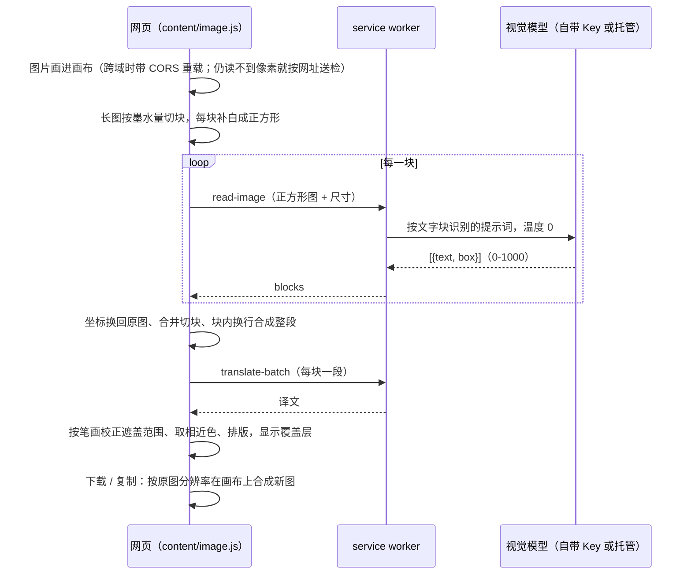

# 图片翻译

> 状态：基础的右键图片翻译已随商店 2.0.0 发布。本文记录的增强功能随扩展 **2.1.0** 打包（2026-10-21），**待上传商店**：
> 框选（矩形 / 圆形、移动与调整大小）、相近色背景、按笔画校正遮盖位置、按文字块识别、导出新图片、送检补白成正方形。
> 托管识图的提示词与温度在后台（`apps/backend/src/translation/hosted.js`），需随后台部署后才对点数翻译生效；
> 补白、校正、框选与导出都在扩展本机完成，不依赖后台。

## 一、用户能做什么

| 入口 | 操作 | 结果 |
| --- | --- | --- |
| 网页里的图片 | 右键「翻译图片里的文字」 | 默认识别整张图并翻译，弹窗里把译文贴着原文位置盖回去 |
| 同上，设置里选了「先框选要翻译的区域」 | 右键后先框选，再点「翻译选区」 | 只识别、翻译框里的文字；一个都不框直接确认就翻译整张图 |
| 扩展图标 →「图片翻译」页 | 上传、粘贴图片或输入图片地址 | 同样支持框选、背景色和导出；页面同时显示识别原文、坐标与模型原始回复，便于排查 |

弹窗（`src/content/image.js`）顶部只放标题、状态与关闭；底部工具栏按模式切换：

- **看结果**：目标语言、背景（相近色 / 深色半透明 / 白 / 黑 / 自定义颜色）、框选区域、显示原图、下载、复制图片。
- **框选**：形状（矩形 / 圆形）、操作提示、取消、翻译选区。按住 Shift 拖出正方形或正圆；按住框内拖动是移动，按住边框（8 像素以内，四角同时调两个方向）是调整大小；圆形沿圆周任何位置都能调整。最多 12 个选区，可以混用两种形状。

## 二、整体流程

框选时把第 2 步换成「从原图裁出各选区拼成一张图」，其余相同。

## 三、识别

**送检前补白成正方形**（`tiles.js` 的 `squareImage` / `squareParts` / `fromSquare`）。视觉模型对非正方形图片给出的坐标很不稳定：同一张 1220×1602 的竖排漫画连识几次，有一半结果下半部分整体下移约两成。原图放在正方形左上角，其余补白，识别回来的坐标按内容所占比例换回原图，落在补白里的丢掉。正方形边长不超过 2048，请求体不会超过托管接口的 8 MiB。

**长图先切块**：高宽比超过 1.6 时按每行墨水量把切缝挪到空白处，最多 8 块，每块再各自补成正方形。

**提示词按文字块识别**（扩展 `providers.js` 与后台 `hosted.js` 用同一份英文原文）：每个对话框、旁白、标题、标签或段落各算一块；说明竖排文字（日文漫画，从上往下、列从右往左）时框要覆盖所有列；忽略注音假名。逐行给坐标再标段落编号的方案实测更差，已经弃用。识图固定温度 0；DeepSeek 关闭思考，否则同样的请求要几十秒、上万个输出 token。

**块内换行合成整段**（`regions.js` 的 `flatten`）：模型返回的一块里常带换行（竖排每一列、横排每一行），原样送去翻译会被逐行翻成碎片。中日文之间直接相连，拉丁文字与韩文用空格，行尾连字符断词接回。整图与框选两条路径都这样处理。

**跨域图片**：画布被污染时先带 `crossOrigin` 重载；仍不行就把网址交给接口取图，这时没法补白、切块、按笔画校正或导出新图，框选也只能从整图识别结果里挑出中心落在选区内的文字。

## 四、框选

- **拼图**（`regions.js` 的 `packRegions` / `stitch` / `readRegions`）：各选区按阅读顺序从左到右排、排满一行换行，行宽取面积开方，拼成接近正方形的一张图；选区之间留 24 像素白边。原图像素总量超过 800 万才另起一批。多个选区通常只发一次识图请求。
- **圆形选区**：拼图时只把圆内的部分画进去，圆外留白；识别结果中心落在圆外的丢掉；按笔画校正时圆外像素当作透明；遮盖与文字都裁剪在圆内，文字排在圆的内接矩形里。
- **合并**：同一选区内的所有文字块合成一段翻译（`groupByRegion`），遮盖范围以选区为界。

## 五、遮盖与排版

**按笔画校正**（`image-render.js` 的 `inkBox` / `refineCover`）：在模型给的框四周放宽 35% 的窗口里（框选时窗口就是选区本身），以最常见的颜色为底色，偏离底色超过 64 的像素算笔画，按小格连成块，然后：

- 碰到窗口边缘的大块（伸进来的画面）、又大又稀疏的块（对话框描边、圆圈）、横竖都比一个字大得多的块、一边超过两个字长而另一边很细的块（线条）都不算；
- 与文字颜色差太多的块不算，文字颜色取「笔画量 × 与底色的反差」最大的那种；
- 落在别的框里、又离那个框中心更近的笔画归那个框；
- 从模型框里的块出发，把相距不到 0.8 个字的块逐个并进来，最多超出模型框一个半字。

结果四周留约三分之一个字，作为遮盖范围；单个字的尺寸（各块长边的四分之三分位）作为译文字号上限。读不到像素或找不到笔画时，退回按框放宽（`coverBox`：单行放出 12% 行高，整段放出 30%）。

**背景色**：相近色取遮盖范围外沿四条像素带里出现最多的颜色（量化后取众数），文字颜色按 WCAG 对比度在黑白里选；取不到颜色时退回深色半透明。

**排版**：二分找最大字号；拉丁文字按词、中日文按字断行；中文句读和右引号不放在行首，左引号不留在行尾。预览覆盖层用 `align-items: safe center`，放不下时只往下溢出，字号适配才能量准。

## 六、导出新图片

`renderImage` 按原图分辨率在画布上合成（超过单边 16384 或总面积 1.2 亿像素时等比缩小），遮盖范围、颜色、字号与预览一致。下载在 400 万像素以内用 PNG，更大用 JPEG（0.92）；复制到剪贴板固定 PNG。下载用 `<a download>` 加 Blob，**不申请 `downloads` 权限**，避免扩展更新后因新权限被停用。跨域读不到像素的图片不能导出，按钮会禁用并说明原因。

## 七、设置

| 键 | 取值 | 默认 | 位置 |
| --- | --- | --- | --- |
| `imageMode` | `auto` / `select` | `auto` | 设置页「图片翻译」卡片 |
| `imageFill` | `auto` / `dark` / `white` / `black` / `custom` | `auto` | 弹窗与图片翻译页的「背景」 |
| `imageFillColor` | `#rrggbb` | `#ffffff` | 选「自定义」时的颜色 |
| `imageShape` | `rect` / `ellipse` | `rect` | 框选时的「形状」 |

## 八、计费与隐私

- 识图本身不扣点，按次计入每小时识图上限；长图每块、框选每张拼图各算一次。译文仍按 500 个 Unicode 码点 = 1 点扣减（见 [点数账本](../backend/credit-accounting.md)）。
- 图片与识别文字不落库、不写日志。导出新图片在本机画布上合成，不额外上传。

## 九、实测

同一张 1220×1602 竖排日文漫画，按人工标注的 9 个对话框计算平均 IoU（真实 DeepSeek Flash，每种方式 3 次）：

| 方式 | 平均 IoU |
| --- | --- |
| 原图送检，逐行坐标加段落编号 | 0.31–0.43 |
| 原图送检，按块识别 | 0.20–0.66（不稳定） |
| 补白成正方形，按块识别 | 0.66–0.71 |
| 再按笔画校正 | 0.80 |

## 十、已知限制

- 照片、渐变上的文字用单一颜色铺底，会看得出补丁；没有做背景修复（inpainting）。
- 与文字同色又紧挨着的画面（贴着字的黑色头发）、白板上画在标签旁的线条，可能被当成笔画，遮盖偏大。
- 圆形选区超出画格时，圆内那一小段画格边框可能被当成笔画。
- 竖排原文译成中文时按横排排版，竖长的遮盖范围里会一字一行。
- 列表这类本该分行的内容如果被模型识别成同一块，会合成一行再翻译。

## 十一、代码与测试

| 文件 | 内容 |
| --- | --- |
| `src/content/image.js` | 右键弹窗：取图、识别、框选、预览、导出 |
| `src/image/` | 独立的图片翻译页 |
| `src/lib/tiles.js` | 长图切块、补白成正方形、坐标换算 |
| `src/lib/regions.js` | 选区拼图与还原、圆形判断、按选区合并、块内换行合成整段 |
| `src/lib/region-picker.js` | 框选交互：新建、移动、调整大小、删除 |
| `src/lib/image-render.js` | 相近色、按笔画校正、排版、导出 |
| `src/lib/providers.js`、后台 `src/translation/hosted.js` | 识图提示词（两边同一份）与温度 |

测试：`test/tiles.mjs`、`test/regions.mjs`、`test/region-picker.mjs`、`test/image-render.mjs`、`test/image.mjs`，后台 `test/hosted.test.mjs`。

## 十二、首页演示视频

`apps/web/public/assets/demo-image.mp4` 由仓库外的 `tools/capture/` 录制（不进 git）：

- 演示图是用 HTML 生成的拉面店海报（竖排招牌、彩色底、圆形角标、菜单与价格），`node make-ramen.mjs` 生成 `pages/ramen.png` 并量出每块文字的位置写进 `pages/ramen-blocks.json`；
- 假接口扮演识图模型：整图按补白后的正方形坐标返回，框选时用扩展自己的 `packRegions` 算出拼图布局，只返回拼图里看得到的文字；译文是预先写好的演示文案；
- 镜头：右键海报 → 整张图翻译 → 下载 → 框选换成圆形、圈住角标并拖动挪正 → 只翻译圈住的角标。

录制、合成与编码命令见 `apps/web/public/assets/README.md`。
