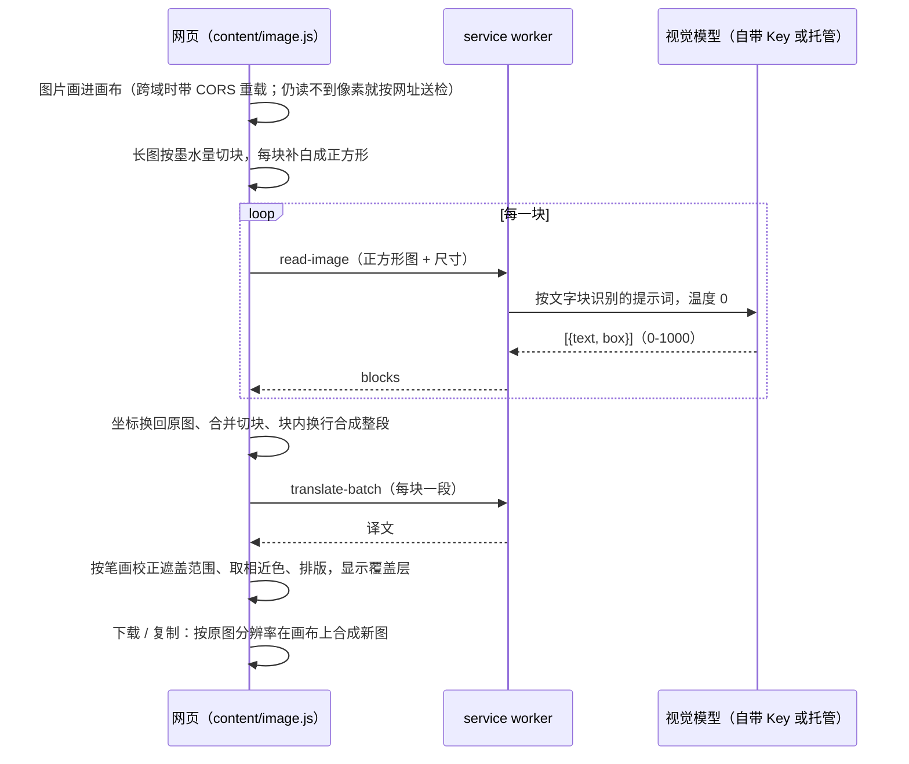

# 图片翻译

> 状态：基础的右键图片翻译已随商店 2.0.0 发布。本文记录的增强功能随扩展 **2.1.0** 打包（2026-10-21），**待上传商店**：
> 框选（矩形 / 圆形、移动与调整大小）、相近色背景、按笔画校正遮盖位置、按文字块识别、导出新图片、送检补白成正方形。
> 托管识图的提示词与温度在后台（`apps/backend/src/translation/hosted.js`），需随后台部署后才对点数翻译生效；
> 补白、校正、框选与导出都在扩展本机完成，不依赖后台。

## 一、用户能做什么

| 入口 | 操作 | 结果 |
| --- | --- | --- |
| 网页里的图片 | 右键「翻译图片里的文字」（默认入口） | 全自动：找出各段文字并按笔画勾成互不重叠的多边形，翻译后按形状铺底色、把译文排在形状附近 |
| 同上，取消勾选弹窗里（或设置页）的「直接翻译」 | 右键后先看到形状，可移动、删除、改顶点、新画，再点「翻译」 | 没动过的形状直接用识别出的原文，改过和新画的按新形状重新识别 |
| 同上，设置里把「右键翻译图片时」改成「先框选要翻译的区域」 | 右键后先框选，再点「翻译选区」 | 只识别、翻译框里的文字；一个都不框直接确认就翻译整张图 |
| 扩展图标 →「图片翻译」页 | 上传、粘贴图片或输入图片地址 | 同样支持框选、背景色和导出；页面同时显示识别原文、坐标与模型原始回复，便于排查 |

**自动识别：按文字形状翻译（随 2.2.0 发布）**。原来自动识别整图后按矩形遮盖，位置和分段问题多；手动框选效果好。现在自动识别仍是独立的全自动功能：

1. **找文字块**：识图请求带 `purpose: 'regions'`，换用单独的提示词（扩展 `providers.js` 与后台 `hosted.js` 的 `REGION_PROMPT`，两边保持一致）：按文字块给出包住整块的框和原文、是否竖排，不同块的框不要重叠，忽略注音、水印、落款、页码等小字。后台只回传 `text`、`box` 与布尔的 `vertical`。
2. **按笔画勾形状**（`src/lib/text-shapes.js`）：在模型框四周放宽 35% 的窗口里用 `inkBox` 找笔画（`withMask` 返回笔画格子和字高），落到长边约 600 格的网格上。笔画按 0.35 个字的间距连成行或整块，整行归框住它最多的那块（领先不到 20% 时才逐格就近分），所以模型的框互相压住时一行字不会被拆给两块。各块从笔画同时向外扩 0.6 个字，把行、列连成一片，相遇处各占一半，每格最多属于一块；再收回到笔画外只留 0.3 个字，补上洞，不同块相邻处各退一格，然后沿格子边缘勾出轮廓，用 Douglas-Peucker（0.8 格）简化成多边形。大半落在模型框外的碎片（旁边的画面线条）丢掉；文字框的边框、对话框描边（又大、笔画几乎都贴着外接框四边）不勾进形状，免得铺底色时盖掉。
3. **字号、底色与对齐**（都在本机按像素量，不靠模型）：
   - **估计值**（`priorEm`）：按模型给的原文字数和框面积先估一个字号（中日韩文每字约 1.25 个字号见方，拉丁文字平均字宽约半个字号）。它不准，只用来定「比字大得多 / 小得多」的门槛，不受笔画粘连、网点影响。
   - **底色**：先取模型框里最常见的颜色；再按框的一圈边取一次，两者不同时留下量出字号更接近估计值的那个（又粗又大的音效字、标题占了框里大半，框里最常见的是字的颜色）。铺底色用这个颜色（`shape.background`），不再在形状外沿取——气泡跨在天空和草地上时外沿取到的是草地的颜色。
   - **只认文字所在那片底色上的笔画**：没有笔画的格子连成片，取模型框里占得最多的一片（气泡、文字框的内部）；不挨着它的笔画（框线另一侧的网点、画面）再近也不算。碰到窗口边缘又比一个半字大的、成片出现且远多于字数的小点（网点、星空）也丢掉。
   - **字号**（`lineMetrics`）：把笔画沿行的方向投影，量每一行（竖排是每一列）的粗细取中位数，再除以笔画占字号的比例（中日韩文 0.92；拉丁文字有 g j p q y 时 0.9，没有时 0.72）。比别的行细得多的（注音、噪点）不算。结果限制在估计值的 0.5–1.8 倍之间。旧做法按单个笔画块的大小量，字的笔画断开（明朝体假名）或粘连成词（英文）时会差出一倍以上。
   - **对齐**：横排多行时，各行起点对齐、终点参差是左对齐，反之右对齐，否则居中；只有一行的，和旁边左（右）对齐的多行文字起点对齐就跟着它。
   - **退回模型的框**：找到的笔画范围不到模型框面积的两成（描边加填色的音效字），或根本找不到笔画时，用模型的矩形，字号用估计值。
4. **小字**：只丢真正的小字——模型框的短边不到门槛的 1.5 倍（单行小字），而且量出来的字也不到图片短边 1.5%（至少 8 个原图像素）。字号只按中心落在模型框里的笔画量：窗口放宽后常带进树林、星空这类细碎纹理。
5. **翻译与覆盖**：每个形状的原文（块内换行合成整段）一次批量翻译，不再按形状重新识图。底色按形状铺（相近色在形状外接框四周取）；译文不受形状限制：从原文字高往下找能放进外接框的最大字号，字号低于原文七成时先往两边加宽（1.4 / 2 / 2.8 / 4 倍），英文等用空格分词的文字不拆词；仍放不下就用最小字号溢出。原文左（右）对齐的段落，译文贴着同一边、从第一行的位置排起；居中的多行在行数不变的前提下把各行排匀，竖排把各列排匀，最后一行（列）不会只剩一两个字；单独一个英文词也不拆开。排好的框以形状中心为中心并挪回图片以内，溢出部分描一圈底色的边。原文竖排、目标语言是中日韩文时译文也竖排（从右往左一列列写，标点换成竖排字形），其他目标语言横排。
6. **预览与导出用同一套画法**（`image-render.js` 的 `layoutShapes` / `drawShapes` / `renderShapes`）：预览画在图片上方等比例的画布里（长边最多 2400 像素），下载、复制按原图分辨率重画。
7. **直接翻译 / 先看形状**：弹窗工具栏（自动识别时才显示）和设置页都有「直接翻译」勾选框，默认勾选，即识别后直接翻译；取消勾选后，下次自动识别先进入形状编辑，点「翻译」才翻译。选择存在设置 `imageReview`（取消勾选为 `true`），之后沿用。形状编辑（`src/lib/shape-editor.js`）：按住形状拖动是移动；选中后拖动顶点改形状，附近的顶点按距离跟着动（权重 (1−d²/r²)²，影响半径取形状外接框长边的三成、24–140 屏幕像素，拖动时画出范围圈；按住 Alt 只动一个点），双击边线加顶点、双击顶点删掉（至少三个），空白处拖出新的矩形或椭圆，选中后点 × 或按 Delete 删除。改过的形状虚线显示；点「翻译」时没动过的形状直接用原文，改过和新画的按多边形裁图拼成一张重新识别（`regions.js` 支持 `shape: 'polygon'`），读不到像素时从整图识别结果里挑中心落在形状里的。翻译完成后不再回到形状编辑；要换范围用「框选区域」手动框选。
8. **等待过程**：一读到图就打开弹窗显示原图，标题栏转圈并写进度；识别完先把文字形状勾在图上（`drawShapePreview`），译文回来再盖上去。失败时错误留在标题栏并给出「重试」（已经识别出形状的只重新翻译）。
9. **翻译后修改单段**：每段译文上有一个热区（`.bubble`），悬停显示原文，拖动挪译文的位置，点一下打开编辑框：改译文、A− / A+ 调字号、只重新翻译这一段、还原。修改记在这一段的 `tweak`（`text`、`scale`、`dx`、`dy`）里，`layoutShapes` 排版时套用（定了字号就不再缩小去适应形状），下载、复制的图片同样带上。
10. **同一张图不重复请求**：内容脚本内存里按「尺寸 + 图片地址」缓存识别出的形状和各目标语言的译文（连同 `tweak`），最多 30 张，页面关掉就没了。再次右键同一张图直接显示；换目标语言只重新翻译；改过形状后该图的旧译文作废。工具栏的「重新识别」丢掉缓存从头再来。
15. **弹窗尺寸**：打开前按原图比例算好画布尺寸（`sizeCanvas`），图片载入前先占位，窗口不会在载入后再跳一下；换图时新图载入前隐藏画布内容，上一张图不会先露出来。
11. **上一张 / 下一张**：页面上有两张以上够大（160 像素见方以上）、已加载、看得见的图时，标题栏显示「第几张 / 共几张」和前后按钮，左右方向键也能翻；翻到的图照常识别翻译，翻译过的直接用缓存。
12. **译文的颜色与底色**：相近色时译文沿用原文的颜色（`inkBox` 量出的笔画颜色，和底色的对比度不到 3 时仍按黑白选）。形状外沿上下或左右两条色带都接近文字的底色、彼此又有差别时（`gradientAt`），底色按这两头的颜色做线性渐变，不留单色补丁。
13. **音效字**（设置 `imageSfx`，默认关闭）：打开后识图请求用 `purpose: 'regions-sfx'`，提示词变体（`REGION_SFX_PROMPT`，两边同一份）不再忽略音效字并让模型标 `sfx: true`；后台只多回传这个布尔值。音效字不做笔画分析、不铺底色，译文用小字（黑字白边）标在原字下面，出了图就标在上面。开和关的识别结果分开缓存。
14. **读不到像素**（跨域图）：退回模型的矩形，重叠部分同样按格子分清归属；下载、复制不可用。

找文字块同样计入每小时识图次数，不扣点；译文按 500 码点 = 1 点扣减。

右键菜单只有一个「翻译图片里的文字」，随 `translate-image` 消息只带图片地址；页面按设置 `imageMode` 决定自动识别（默认）还是先框选。弹窗里两种方式都能切换。

## 二、整体流程

框选时把第 2 步换成「从原图裁出各选区拼成一张图」，其余相同。

## 三、识别

**送检前补白成正方形**（`tiles.js` 的 `squareImage` / `squareParts` / `fromSquare`）。视觉模型对非正方形图片给出的坐标很不稳定：同一张 1220×1602 的竖排漫画连识几次，有一半结果下半部分整体下移约两成。原图放在正方形左上角，其余补白，识别回来的坐标按内容所占比例换回原图，落在补白里的丢掉。正方形边长不超过 2048，请求体不会超过托管接口的 8 MiB。

**长图先切块**：高宽比超过 1.6 时按每行墨水量把切缝挪到空白处，最多 8 块，每块再各自补成正方形。

**提示词按文字块识别**（扩展 `providers.js` 与后台 `hosted.js` 用同一份英文原文）：每个对话框、旁白、标题、标签或段落各算一块；说明竖排文字（日文漫画，从上往下、列从右往左）时框要覆盖所有列；忽略注音假名。逐行给坐标再标段落编号的方案实测更差，已经弃用。识图固定温度 0；DeepSeek 关闭思考，否则同样的请求要几十秒、上万个输出 token。

**块内换行合成整段**（`regions.js` 的 `flatten`）：模型返回的一块里常带换行（竖排每一列、横排每一行），原样送去翻译会被逐行翻成碎片。中日文之间直接相连，拉丁文字与韩文用空格，行尾连字符断词接回。整图与框选两条路径都这样处理。

**跨域图片**：画布被污染时先带 `crossOrigin` 重载；仍不行就把网址交给接口取图，这时没法补白、切块、按笔画校正或导出新图，框选也只能从整图识别结果里挑出中心落在选区内的文字。

## 四、框选

- **拼图**（`regions.js` 的 `packRegions` / `stitch` / `readRegions`）：各选区按阅读顺序从左到右排、排满一行换行，行宽取面积开方，拼成接近正方形的一张图；选区之间留 24 像素白边。原图像素总量超过 800 万才另起一批。多个选区通常只发一次识图请求。
- **圆形选区**：拼图时只把圆内的部分画进去，圆外留白；识别结果中心落在圆外的丢掉；按笔画校正时圆外像素当作透明；遮盖与文字都裁剪在圆内，文字排在圆的内接矩形里。
- **合并**：同一选区内的所有文字块合成一段翻译（`groupByRegion`），遮盖范围以选区为界。

## 五、遮盖与排版

**按笔画校正**（`image-render.js` 的 `inkBox` / `refineCover`）：在模型给的框四周放宽 35% 的窗口里（框选时窗口就是选区本身），以最常见的颜色为底色，偏离底色超过 64 的像素算笔画，按小格连成块，然后：

- 碰到窗口边缘的大块（伸进来的画面）、又大又稀疏的块（对话框描边、圆圈）、横竖都比一个字大得多的块、一边超过两个字长而另一边很细的块（线条）都不算；
- 与文字颜色差太多的块不算，文字颜色取「笔画量 × 与底色的反差」最大的那种；
- 落在别的框里、又离那个框中心更近的笔画归那个框；
- 从模型框里的块出发，把相距不到 0.8 个字的块逐个并进来，最多超出模型框一个半字。

结果四周留约三分之一个字，作为遮盖范围；单个字的尺寸（各块长边的四分之三分位）作为译文字号上限。读不到像素或找不到笔画时，退回按框放宽（`coverBox`：单行放出 12% 行高，整段放出 30%）。

**背景色**：相近色取遮盖范围外沿四条像素带里出现最多的颜色（量化后取众数），文字颜色按 WCAG 对比度在黑白里选；取不到颜色时退回深色半透明。

**排版**：二分找最大字号；拉丁文字按词、中日文按字断行；中文句读和右引号不放在行首，左引号不留在行尾。预览覆盖层用 `align-items: safe center`，放不下时只往下溢出，字号适配才能量准。

## 六、导出新图片

`renderImage` 按原图分辨率在画布上合成（超过单边 16384 或总面积 1.2 亿像素时等比缩小），遮盖范围、颜色、字号与预览一致。下载在 400 万像素以内用 PNG，更大用 JPEG（0.92）；复制到剪贴板固定 PNG。下载用 `<a download>` 加 Blob，**不申请 `downloads` 权限**，避免扩展更新后因新权限被停用。跨域读不到像素的图片不能导出，按钮会禁用并说明原因。

## 七、设置

| 键 | 取值 | 默认 | 位置 |
| --- | --- | --- | --- |
| `imageMode` | `auto` / `select` | `auto` | 设置页「右键翻译图片时」 |
| `imageReview` | 布尔 | `false` | 弹窗与设置页的「直接翻译」（取消勾选为 `true`） |
| `imageSfx` | 布尔 | `false` | 设置页「翻译音效字」 |
| `imageFill` | `auto` / `dark` / `white` / `black` / `custom` | `auto` | 弹窗与图片翻译页的「背景」 |
| `imageFillColor` | `#rrggbb` | `#ffffff` | 选「自定义」时的颜色 |
| `imageShape` | `rect` / `ellipse` | `rect` | 框选时的「形状」 |

## 八、计费与隐私

- 识图本身不扣点，按次计入每小时识图上限；长图每块、框选每张拼图各算一次。译文仍按 500 个 Unicode 码点 = 1 点扣减（见 [点数账本](../backend/credit-accounting.md)）。
- 图片与识别文字不落库、不写日志。导出新图片在本机画布上合成，不额外上传。

## 九、实测

同一张 1220×1602 竖排日文漫画，按人工标注的 9 个对话框计算平均 IoU（真实 DeepSeek Flash，每种方式 3 次）：

| 方式 | 平均 IoU |
| --- | --- |
| 原图送检，逐行坐标加段落编号 | 0.31–0.43 |
| 原图送检，按块识别 | 0.20–0.66（不稳定） |
| 补白成正方形，按块识别 | 0.66–0.71 |
| 再按笔画校正 | 0.80 |

## 十、已知限制

- 照片、渐变上的文字用单一颜色铺底，会看得出补丁；没有做背景修复（inpainting）。
- 与文字同色又紧挨着的画面（贴着字的黑色头发）、白板上画在标签旁的线条，可能被当成笔画，遮盖偏大。
- 圆形选区超出画格时，圆内那一小段画格边框可能被当成笔画。
- 竖排原文译成中文时按横排排版，竖长的遮盖范围里会一字一行。
- 列表这类本该分行的内容如果被模型识别成同一块，会合成一行再翻译。

## 十一、代码与测试

| 文件 | 内容 |
| --- | --- |
| `src/content/image.js` | 右键弹窗：取图、识别、框选、预览、导出 |
| `src/image/` | 独立的图片翻译页 |
| `src/lib/tiles.js` | 长图切块、补白成正方形、坐标换算 |
| `src/lib/regions.js` | 选区拼图与还原、圆形判断、按选区合并、块内换行合成整段 |
| `src/lib/region-picker.js` | 框选交互：新建、移动、调整大小、删除 |
| `src/lib/text-shapes.js` | 自动识别：按笔画勾出互不重叠的文字形状 |
| `src/lib/shape-editor.js` | 形状编辑：移动、改顶点、加删顶点、新画、删除 |
| `src/lib/image-render.js` | 相近色、按笔画校正、排版（含按形状排版与竖排）、导出 |
| `src/lib/providers.js`、后台 `src/translation/hosted.js` | 识图提示词（两边同一份）与温度 |

测试：`test/tiles.mjs`、`test/regions.mjs`、`test/region-picker.mjs`、`test/text-shapes.mjs`、`test/shape-editor.mjs`、`test/image-render.mjs`、`test/image.mjs`，后台 `test/hosted.test.mjs`。

## 十二、首页演示视频

`apps/web/public/assets/demo-image.mp4` 由仓库外的 `tools/capture/` 录制（不进 git）：

- 演示图是用 HTML 生成的拉面店海报（竖排招牌、彩色底、圆形角标、菜单与价格），`node make-ramen.mjs` 生成 `pages/ramen.png` 并量出每块文字的位置写进 `pages/ramen-blocks.json`；
- 假接口扮演识图模型：整图按补白后的正方形坐标返回，框选时用扩展自己的 `packRegions` 算出拼图布局，只返回拼图里看得到的文字；译文是预先写好的演示文案；
- 镜头：右键海报 → 整张图翻译 → 下载 → 框选换成圆形、圈住角标并拖动挪正 → 只翻译圈住的角标。

录制、合成与编码命令见 `apps/web/public/assets/README.md`。
