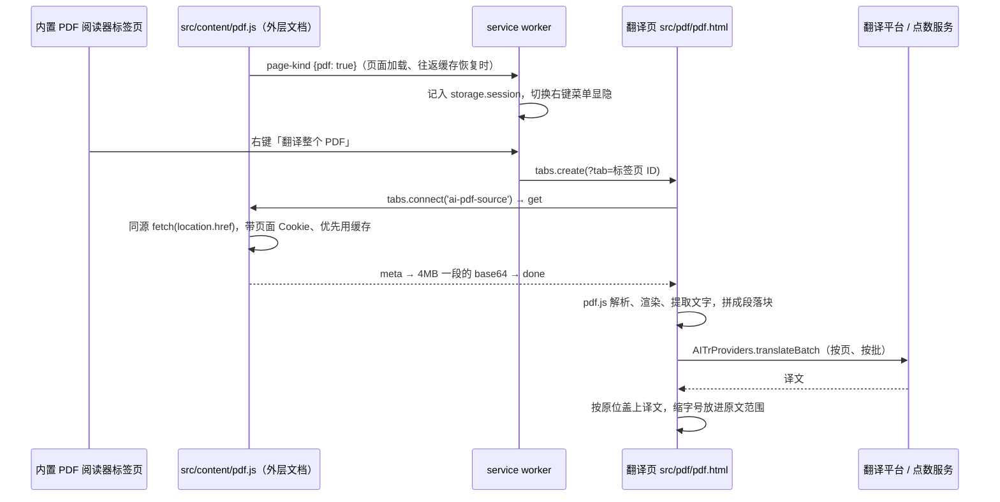

# 整份 PDF 翻译

> 状态：代码已在 `main`，**尚未随商店版本发布**（商店当前为 2.0.0）。
> 本地在无头 Chrome for Testing 150 与正式版 Chrome 155 上验证过；原生右键菜单无法自动点击，由人工在 Chrome 里确认。
> 发布前还要完成文末「发布前待办」。

## 一、用户能做什么

| 场景 | 操作 | 结果 |
| --- | --- | --- |
| Chrome 内置 PDF 阅读器，选中了文字 | 右键「翻译成…」 | 原有划词翻译弹窗 |
| Chrome 内置 PDF 阅读器，没选中文字 | 右键「翻译整个 PDF」 | 在右侧新标签页打开翻译页，自动开始翻译 |
| 本地或任意 PDF 文件 | 拖入或选择到翻译页 | 同上 |

翻译页（`src/pdf/pdf.html`）：

- **显示方式**：对照（原文、译文并排）、只看译文、只看原文。译文盖在原文位置上，版面、图表、表格线保持不变。
- **翻译**：从当前看到的页开始往后翻，再回头翻前面的页，同时翻 2 页；可停止、继续。换目标语言或平台会清空译文后重翻。
- **等待效果**：正在翻译的页上，每个待翻译段落先显示灰色骨架条和扫光，页顶有进度条，页标签闪烁。
- **下载**：「下载 PDF」调用浏览器打印，在打印窗口选「另存为 PDF」。默认文件名为「原文件名 (目标语言)」，内容跟随当前显示方式，译文是可选中、可搜索的文字。
- **平台**：与扩展其他功能相同，支持点数翻译（托管）和自带 Key（OpenAI 兼容、DeepSeek、DeepL）。

## 二、整体流程

## 三、各部分实现

### 1. 右键菜单（`src/background.js`）

- 新增菜单项 `ai-translate-pdf`，与「为这个区域添加翻译按钮」（`ai-translate-element`）按「当前标签页是不是 PDF」**互斥显示**，任何时刻只出一项，不会被 Chrome 折叠成二级菜单。
- `contexts: ['page', 'frame']`：内置阅读器的正文是嵌套子框架里的插件，在上面右键时 Chrome 不算 `page`，只匹配 `frame`。代价是 PDF 里选中文字右键时，它会和划词项一起出现（折叠成扩展名下的子菜单）。
- PDF 标签页由内容脚本上报（`page-kind`，只采信顶层框架；阅读器里还嵌着同地址的子框架），存进 `chrome.storage.session` 的 `pdfTabs`，service worker 重启后仍可用。
- 切换时机：`tabs.onActivated`、`windows.onFocusChanged`、当前标签页的上报；重建菜单（`createMenu`）时按当前标签页决定初始显隐；标签页关闭时移除记录。
- 相关修复：划词菜单原来在内容脚本上报「空选区」时会被隐藏。菜单显隐是全局的，而内置 PDF 阅读器里内容脚本读不到选区，别的网页点一下空白就会让 PDF 里再也右键不出划词项。现在空选区不再隐藏菜单（`contexts: ['selection']` 本来就只在有选区时出现），只有选中的全是数字、标点时才隐藏。

### 2. 取得 PDF 字节（`src/content/pdf.js`）

- 只在顶层框架、且 `document.contentType === 'application/pdf'` 时工作。内置阅读器的外层文档可以注入内容脚本，阅读器内部（`chrome-extension://mhjf…` 框架）不能。
- 翻译页用 `chrome.tabs.connect(tabId, { name: 'ai-pdf-source', frameId: 0 })` 连进来。只有扩展页面能连到内容脚本，网页不能。
- 内容脚本同源 `fetch(location.href, { credentials: 'include', cache: 'force-cache' })`：带着站点 Cookie，优先复用浏览器刚下载的缓存，**不需要新增站点权限**。
- 分段传输：每段 4MB 原始字节转 base64，远低于扩展消息 64MB 上限；超过 200MB 直接拒绝。
- 取不到时翻译页自己再试：`file://` 用 XHR（需要用户在扩展详情里打开「允许访问文件网址」），其他地址用 `fetch`（受 CORS 与站点权限限制）。都失败时显示拖入文件的入口。
- 读取成功后翻译页把 `?tab=…&src=…` 写回地址栏，刷新时还能再读一次。

### 3. 解析与渲染（`src/pdf/pdf.js` + `src/vendor/pdfjs/`）

- pdf.js 以 `useWasm: false`、`isEvalSupported: false`、`enableXfa: false` 加载；`cMapUrl`、`standardFontDataUrl` 指向扩展内的 `cmaps/`、`standard_fonts/`，中日韩字体映射和未嵌入的标准字体都能正确处理。
- 每页按需渲染：`IntersectionObserver`（上下 1200px 预加载）进入视野时排队渲染，串行进行；倍率 2，总像素封顶 500 万，渲染后转成 JPEG 的 Blob URL，原文页和译文页共用一张底图，画布随即释放。
- 文字坐标：`Util.transform(viewport.transform, item.transform)` 换算到页面左上角为原点的像素（缩放 1）；字号取变换矩阵的纵向长度；竖排、旋转文字标记为 `rotated`，不翻译。

### 4. 拼段落（`src/lib/pdf-layout.js`，纯函数，`test/pdf-layout.mjs`）

PDF 只有一串带坐标的文字片段，没有段落。按内容流顺序做两步合并（大多数排版器的内容流就是阅读顺序，双栏也是先左后右）：

- **片段 → 行**：基线接近、从左往右接着排、中间空隙不超过 2.2 个字宽。
  - pdf.js 会在相隔较远的两段文字之间插入纯空白片段，宽度横跨整个空隙。空白片段只当作「这里有空格」，**不计入行宽**；宽度超过 1 个字宽的空白片段视为分格（正文的词间空格本来就在文字片段里）。否则表格同一行的各格会被连成一行。
- **行 → 块**：字号相差不到 1.3 倍、在上一行下面、行距以内（段间空白小于 0.75 个字号）、水平方向有重叠，且满足：
  - **表格单元格**不上下合并：同一条基线上还有别的行、且自身短于 15 个字宽的行视为格子。双栏正文每行都很长，不受影响。格子与普通行相接（表格标题接表头、格内换行）只在左边对齐时合并。
  - **上一行明显变短**（比本段宽度短 8 个字宽以上，或短 30% 以上）时另起一块：段落在那里结束，或者它是小标题。
  - **上下两行字体完全不重合**时另起一块（粗体小标题接正文）。行内夹几个粗体词时仍有共用的正文字体，不受影响。
  - 单块超过 1200 字时在行边界切开。
- 合并文字：英文行尾连字符断开的词接回（本来带连字符的复合词只去掉换行、保留连字符）；中日韩文字之间不补空格。
- 字母少于 2 个的块（页码、数字格、公式编号）不送去翻译，原样保留。
- 覆盖范围外扩：PDF 记录的字宽常比实际渲染略窄，块向右多盖 0.6 个字宽；表格格子只扩 0.15 个字宽，避免盖掉表格线。

### 5. 翻译

- 切批：每批最多 25 段、2200 字（与区域翻译同一量级，远低于托管接口单次 6000 字、100 段的上限）。
- 调用 `AITrProviders.translateBatch`：点数翻译经 service worker 的 `hosted-translate` 消息转发（只接受扩展页面），自带 Key 直接从翻译页请求所选平台。
- 返回段数不对、或任何一页失败，整体停下并提示（缺 Key、点数不足、限频会让每页都失败，不能一直重试）；已翻好的页保留，「继续翻译」只翻剩下的。
- 点数按实际送出的字数精确扣减，与其他文字托管相同（500 个 Unicode 码点 = 1 点）。

### 6. 盖回原位

- 每个译文块是绝对定位的 `div.blk`，位置与宽高用页面百分比，字号用容器宽度单位 `cqw`（`.sheet` 设 `container-type: inline-size`）。缩放窗口、切换视图、打印都按比例走，不用重新排版。
- 字号自适应：从原字号开始，每次缩小 10%，直到放进原文范围，最多缩到原字号的 45%。看不到的译文页（例如「只看原文」）切过去时再排。
- 底色与字色：在渲染出的页面上，底色取块内**出现最多的颜色**（16 级量化后计数，文字笔画只占少数像素，也不会被贴边的表格线带偏）；字色取与底色差别最大的像素，差别太小时按底色亮度选黑或白。
- 译文用 `textContent` 写入，从不当作 HTML；按目标语言设置 `dir` 与 `lang`。

### 7. 下载

- 先串行渲染所有页、等图片解码、把所有译文页排好字号，再调用 `window.print()`。
- 打印样式：隐藏工具栏，每行（原文页 / 译文页 / 对照的两页）占一张纸；纸张尺寸按第一页写进 `@page`（对照模式宽度翻倍），边距为 0。
- 打印窗口用标题作默认文件名；`afterprint` 时恢复原标题。
- 有页没翻完时先确认，未翻完的页按原文导出。

## 四、权限、隐私与安装包

- **不新增权限**：用到的 `contextMenus`、`storage`、`<all_urls>` 内容脚本、`tabs.connect` 都是已有能力；`storage.session` 不需要额外声明。
- **文件不上传**：PDF 在本机解析和渲染；只有提取出的文字按所选模式发给翻译平台或点数服务，与划词、区域翻译相同。点数服务不保存原文与译文。
- **CSP 不变**：pdf.js 以纯 JS 方式运行（wasm 改用自带的 JS 回退），扩展页面不需要 `wasm-unsafe-eval`。
- **安装包变大**：`src/vendor/pdfjs` 约 4.7MB（字符映射 1.6MB、标准字体 0.8MB、wasm 回退 0.6MB、主体与 worker 约 1.8MB），ZIP 从约 0.5MB 增到约 2.8MB。

## 五、限制

- **扫描件**：没有文字层的页面无法提取文字，全书都没有时提示暂不支持。后续可以接入现有的托管图片识别。
- **有密码的 PDF**：暂不支持；不处理表单和注释的翻译。
- **超过 200MB**：直接拒绝；内容脚本取到的字节经消息传给翻译页，大文件会占用较多内存。
- **快捷键**：内置阅读器里内容脚本读不到选区，快捷键划词不可用，只能右键。
- **版面判断是启发式的**：复杂版式（多栏混排、图文环绕、竖排、公式）可能分块不准；居中的多行标题会逐行成块。
- **下载需要打印窗口**：不能一键直接存文件；导出的底图是 JPEG，原文部分不可选中。
- **不缓存**：关闭翻译页后译文不保留；换目标语言或平台会整份重翻、重新计费。
- **限频**：托管接口每用户每分钟 60 次请求；很大的文件可能触发限频而停下，稍后点「继续翻译」。
- **已打开的标签页**：重新加载或更新扩展后，之前打开的 PDF 标签页没有内容脚本，需要刷新该标签页才会出现菜单项。
- **其他 PDF 阅读器**：只识别 Chrome 内置阅读器（外层文档的 `contentType` 为 `application/pdf`）；网站自带的 pdf.js 阅读器等页面不显示此菜单项，可下载后拖入翻译页。

## 六、测试

- `apps/extension/test/pdf-layout.mjs`：行与块的合并、双栏、表格（含 pdf.js 横跨整格的空白片段与窄格距）、小标题与段尾、连字符、中日韩、切块与切批。
- `apps/extension/test/menu.mjs`：PDF 项与区域项互斥、子框架上报不算、切换标签页、service worker 重建后的显隐、空选区不隐藏划词菜单。
- 本地端到端脚本在 `tools/capture/`（不提交，见仓库约定）：`pdf-e2e.mjs`（自造 PDF，含菜单切换、分块、翻译、对照、导出）、`pdf-real-e2e.mjs <url> [--busy]`（真实 PDF 截图，可截翻译中的效果）、`pdf-items.mjs`（导出某页的 pdf.js 文字片段）、`pdf-real.mjs`（用本机正式版 Chrome 检查上报与菜单状态）。翻译走 `lib/mock-api.mjs` 的本地假接口。

## 七、升级 pdf.js

`src/vendor/pdfjs/README.md` 记录了版本与保留的文件。升级时：

1. `npm pack pdfjs-dist@<版本>` 到临时目录（不进仓库），确认许可证不变。
2. 用 **legacy 构建**的 `pdf.min.mjs`、`pdf.worker.min.mjs` 整体替换；标准构建依赖较新的 JS 特性（例如 `Map.prototype.getOrInsertComputed`），扩展最低支持 Chrome 116。
3. 同步替换 `cmaps/`、`standard_fonts/` 与 `wasm/` 里的 `*_nowasm_fallback.js` 及许可证文件。
4. 更新 README 里的版本号，跑扩展测试与上面的端到端脚本。

`src/vendor/` 已从界面文案提取、文案监听和语法检查中排除。

## 八、发布前待办

- [ ] 在正式版 Chrome 上人工确认：右键菜单项、选中文字时的子菜单、`file://` PDF、打印另存为 PDF。
- [ ] 用真实平台（点数翻译、DeepSeek、DeepL）各翻一份长文档，核对质量、耗时与扣点。
- [x] 隐私政策（`PRIVACY.md`、`apps/web/public/privacy.html`，2026-10-20）：数据表新增「你翻译的 PDF 中提取的文字」，新增「整份 PDF 翻译」一节（本机解析、同源重新读取当前 PDF、文件不上传），内容脚本一栏说明会识别内置 PDF 阅读器。三处都标注「尚未发布」。
- [x] 官网更新日志预告条目（`apps/web/public/changelog.html` 的 `#next`，「下一版 · 即将发布」）。预告条目不写 `data-release-version`，网站检查仍以 manifest 的版本为最新发布。
- [ ] 发布时：隐私政策去掉三处「尚未发布」并更新日期；更新日志把 `#next` 改成正式条目（版本号、日期、`id`、`data-release-version`），同步首页版本；两处改完都要重跑 `npm run build:web` 补齐各语言译文。
- [ ] 商店描述与截图。
- [ ] 提升 `manifest.json` 版本号并打包。
