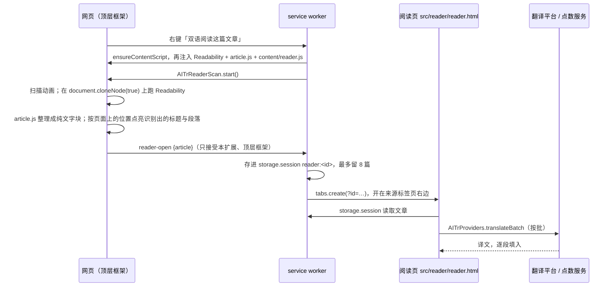

# 双语阅读

> 状态：已在本地实现（2026-11-06），**尚未打包发布**（manifest 仍为 2.1.0）。
> 在无头 Chrome for Testing 150 上用本地端到端脚本验证过；原生右键菜单无法自动点击，需要人工在 Chrome 里确认。

## 一、用户能做什么

| 场景 | 操作 | 结果 |
| --- | --- | --- |
| 普通网页，没选中文字、也不在图片或链接上 | 右键「双语阅读这篇文章」 | 页面上播放扫描动画，识别出标题与正文后，在右侧新标签页打开阅读页并自动翻译 |
| 页面不太像一篇完整的文章（首页、列表页、短帖） | 同上 | 扫描结束后提示「不太像一篇完整的文章」，可「仍然打开」或取消 |
| 页面几乎没有正文 | 同上 | 提示没有找到可以阅读的正文 |

右键菜单里它与「为这个区域添加翻译按钮」同属 `page` 上下文，两项会一起出现，Chrome 把它们收进扩展名下的子菜单。内置 PDF 阅读器里这两项都隐藏，改出「翻译整个 PDF」。

阅读页（`src/reader/reader.html`）：

- **显示方式**：并排（原文左、译文右，每段顶端对齐）、上下（每段原文下面紧跟译文）、只看译文、只看原文。窗口窄于 760px 时并排自动换成上下。
- **对齐**：每段原文与它的译文放在同一行网格里，行高取两边较高者，所以无论译文长短，下一段总是在同一高度开始。鼠标悬停时整行浅浅托出。
- **结构**：大标题、作者与日期、小标题、段落、列表（编号与嵌套层级）、引用、图片与图注、表格（逐格翻译）、代码（不翻译）、分隔线。
- **翻译**：打开即从当前看到的位置开始，按批（每批最多 20 段、2000 字）同时翻 2 批，译文逐批淡入；还没翻到的段落显示与原文长度相当的骨架条。可停止、继续；换目标语言或平台会重新翻译。
- **换说法**（类似 DeepL）：译文按词切开，鼠标移上去浅浅托起；点一个词，或在一段译文里拖选几个词，弹出「其他译法」：顶部是选中的词和它对应的原文（原文那一侧同时标出），下面最多 5 个可直接替换的说法，各带一句很短的区别说明（用界面语言），也可以在输入框里自己改写。替换后这一段立即更新；如果全文别处也有同一个词，底部提示「全文还有 N 处」，可以一键全部替换，让术语前后一致。改过的段落可以「恢复这一段的原译文」。
- **样式**（右上角「Aa」）：主题（自动 / 纸色 / 白色 / 米黄 / 护眼 / 夜间）、字体（无衬线 / 衬线 / 楷体）、字号 13–26px、行距 1.4–2.4、版心（窄 / 适中 / 宽）、淡化（不淡化 / 淡化原文 / 淡化译文），以及恢复默认。改动立即保存到 `chrome.storage.local` 的 `readerStyle`，所有阅读页共用并实时同步；显示方式也一起记住。
- **默认外观**取自 huaci.app 的「纸与墨」：纸色底 `#f6f5f1`、墨色正文 `#1d1c19`、品牌靛蓝 `#4a4fc0` 只做点缀，标题用官网的衬线字体栈、正文用官网的无衬线字体栈，行距 1.75；深色系统下「自动」跟随官网深色配色。字号默认 16px（官网正文是 14px，用在长文阅读上偏小）。
- **平台**：与扩展其他功能相同，支持点数翻译（托管）和自带 Key（OpenAI 兼容、DeepSeek、DeepL）。

## 二、整体流程

## 三、各部分实现

### 1. 右键菜单与注入（`src/background.js`）

- 菜单项 `ai-reader`，`contexts: ['page']`，标题「双语阅读这篇文章」。显隐跟区域按钮一致：PDF 标签页里隐藏（`syncPageMenus`、`createMenu`）。
- 识别脚本不常驻：点菜单时先 `ensureContentScript`（保证 `AITrI18n`、`AITrLifecycle` 等基础脚本在位），再向 `frameIds: [0]` 注入 `READER_FILES`，最后用 `func` 调 `AITrReaderScan.start()`。重复点击时脚本自己判断，已在扫描就不再开第二层。
- `reader-open` 只接受 `sender.id` 为本扩展、`frameId` 为 0、带 `tab` 的消息；文章必须是带 `blocks` 数组的对象，序列化后不超过 4MB。
- 文章存进 `chrome.storage.session` 的 `reader:<uuid>`，`readerIds` 记录顺序，超过 8 篇删掉最旧的；配额不够时清掉其余旧文章再存。刷新阅读页还能读到，关闭浏览器后失效（阅读页显示「这篇文章已经不在了」）。

### 2. 扫描与识别（`src/content/reader.js`）

- 扫描层是闭合 Shadow DOM 里的固定定位层，不拦截页面点击（只有底部提示条可点）；Esc 取消。扩展更新后由 `AITrLifecycle.onRetire` 撤掉。
- 动画：一道带细横纹的靛蓝光带自上而下循环扫过（`transform` 动画，跑在合成线程上，识别占住主线程时也不卡），页面略微降低饱和度。识别完成后，在当前可见区域里找到与识别结果文字相同的元素，画出点亮框，延迟按元素的纵向位置排开，看起来像光带扫到哪里亮到哪里；标题框带「标题」标签。紧挨着、左右对齐的框（列表项）合成一个。
- 动画至少播放 1.5 秒，识别通常几十毫秒就完成，太快一闪而过反而像出错。
- 识别：`isProbablyReaderable(document)` 判断整页像不像文章；`new Readability(document.cloneNode(true), { charThreshold: 300, serializer: (node) => node }).parse()` 在副本上识别（Readability 会改动传入的文档）。
- 标题：Readability 不认「—」等分隔符，会把「标题 — 站点」整个当标题。页面上有与之相符的 `h1` 时用 `h1`，否则去掉与站点名相同的那一段。
- 判断（`AITrArticle.assess`）：正文（段落、列表、引用）折算字数不到 140 为 `none`；有标题、折算字数不少于 700、至少 3 段 60 字以上的段落、且整页像文章时为 `article`，直接打开；其余为 `weak`，让用户决定。中日韩一个字折算成 2.5 个字符。

### 3. 整理成段落（`src/lib/article.js`，`test/article.mjs`）

- 只读节点的 `nodeType`、`tagName`、`childNodes`、`nodeValue`、`getAttribute`，测试里用最小的假 DOM。
- 行内元素（`a`、`em`、`strong`、`code`、`sup` 等）的文字原样连起来，不插空格，中文不会被拆开；` ` 保留为换行。行内元素里夹着块级元素时当容器展开。
- 文章里的 `h1` 降成 `h2`，`h5`/`h6` 并入 `h4`；正文开头与大标题相同的标题、开头两块里包含作者名的短署名行跳过（阅读页顶部已经显示）。
- 列表记下编号起点（`start`）、是否有序和嵌套层级；`blockquote` 里的多个段落都标成引用；`pre` 原样保留缩进，不翻译。
- 图片只接受 http(s) 地址，按 `src`、`data-src`、`data-original`、`srcset`（取最后一项）依次尝试，相对地址按页面地址补全；`data:`、`javascript:` 等一律丢弃。`figure` 的图注归到最后一张图。
- 表格逐格翻译；只有一列的表格多半是排版用的，当普通段落。脚本、样式、表单、按钮、导航、媒体嵌入跳过。
- 超过 1800 字的段落在句末标点处切开；总量最多 2000 块、20 万字，超出时标记 `truncated`，阅读页末尾提示只显示了前面的部分。

### 4. 换说法

- 分词：`Intl.Segmenter(目标语言, { granularity: 'word' })`，每个 `isWordLike` 片段一个 `span.w`，记下它在这一段译文里的起止位置；空格与标点保持纯文字。中日韩、泰文由浏览器内置词典切分。
- 选中范围：点词取该词；拖选时用 Range 算出在这一段译文里的起止位置（跨段不处理），去掉两端空白，最长 200 个字符。
- 请求（`AITrProviders.alternatives`）：把原文段落、选中部分以及它前后的译文分开发给模型（JSON），要求最多 5 个能直接放回原句的说法、按好坏排序、附简短说明，并指出对应的原文词语。回复只保留文字与说明，去掉与当前选中相同或重复的项。提示词在扩展 `providers.js` 与后台 `hosted.js` 各有一份，`test/alternatives.mjs` 检查两边一致。
  - 大模型平台（OpenAI 兼容、DeepSeek）：阅读页直接请求。
  - 点数翻译：经 service worker 的 `hosted-alternatives`（只接受扩展页面）调用后台 `POST /api/extension/alternatives`，按原文段落字数扣点（订阅用户不扣），失败返还；详见 `docs/backend/credit-accounting.md`。
  - DeepL：接口没有这项能力，弹窗提示不支持，仍可自己改写。
- 同一段、同一位置、同一译文只请求一次：缓存的是请求本身，关掉再点、双击选词都不会重复扣点。换目标语言或平台、重新翻译后缓存失效。
- 全部替换：西文按整词匹配（前后不是字母或数字），中日韩、泰文按字面匹配；只在用户点「全部替换」后才改。
- 替换只改阅读页里的显示，不回写平台，也不跨会话保存；重新翻译会恢复平台的译文。

### 5. 阅读页（`src/reader/`）

- 只用 `textContent` 写文字，按块类型重建元素，从不使用网页的 HTML；图片再校验一次协议，加 `referrerPolicy = 'no-referrer'`、懒加载，加载失败时去掉（有图注则只去掉图片）。原文元素标上网页的 `lang`/`dir`，译文元素按目标语言标 `lang`/`dir`，字体回退与断词各自正确。
- 每段是一个 `.pair` 网格（两列 `minmax(0, 1fr)`），图片、代码、分隔线跨两列。并排时中间一条发丝线。
- 样式全部由 `<html data-theme|data-font|data-width|data-dim>` 与 `--size`、`--leading` 两个变量控制；字号、段距、标题都用 `em` 跟随字号。
- 翻译调用 `AITrProviders.translateBatch`：点数翻译经 service worker 的 `hosted-translate` 消息转发（只接受扩展页面），自带 Key 直接从阅读页请求所选平台。返回段数不对、或任何一批失败，整体停下并提示（缺 Key 时给「打开设置」，其他给「重试」）；已翻好的保留，「继续翻译」只翻剩下的。
- 点数按实际送出的字数精确扣减，与其他文字托管相同（500 个 Unicode 码点 = 1 点）。打开阅读页即自动翻译整篇文章。

## 四、权限、隐私与安装包

- **不新增权限**：`contextMenus`、`scripting`、`storage`（含 `storage.session`）、`<all_urls>` 都是已有能力；常驻内容脚本列表不变。
- **页面内容**：正文在本机识别；只有整理后的文字（含图注、表格单元格）按所选模式发给翻译平台或点数服务，与划词、区域翻译、整份 PDF 相同。文章暂存在浏览器会话存储里，不上传、不跨会话保留。阅读页直接请求文章里的图片地址（不带 Referer）。
- **安装包**：`src/vendor/readability/` 约 95KB（未压缩），只在用户点击菜单时注入。

## 五、限制

- **识别是启发式的**：Readability 适合新闻、博客、文档类页面；论坛、社交网络、单页应用、需要登录或分页的文章可能识别不全或识别成别的内容。识别结果只取页面当前已加载的内容（无限滚动后面的部分、折叠的内容不会出现）。
- **行内格式**：链接、粗体、斜体、行内代码、公式只保留文字；脚注编号会并进正文。
- **子框架**：只识别顶层页面，`iframe` 里的文章不处理。
- **不缓存译文**：刷新阅读页、换目标语言或平台都会重新翻译、重新计费；文章本身在会话内保留。
- **图片**：防盗链或需要 Cookie 的图片可能显示不出来（阅读页不带 Referer，也不在原站点下）。
- **已打开的标签页**：重新加载或更新扩展后，旧标签页里的内容脚本由后台按需补注入，通常无需刷新。

## 六、测试

- `apps/extension/test/article.mjs`：段落与行内元素、` `、小标题降级、列表编号与嵌套、引用、代码、图片地址过滤与补全、表格、署名行、长段切分与总量上限、文章判断（含中日韩折算）、切批与可翻译判断。
- `apps/extension/test/alternatives.mjs`：换说法的请求形态（原文、选中前后的译文分开发送、说明语言）、结果清理、DeepL 不支持、缺 Key、点数翻译经 service worker 转发，以及扩展与后台提示词一致。
- `apps/backend/test/hosted.test.mjs`、`extension.test.mjs`：后台换说法的提示词与解析、主力失败改用备用；接口按原文段落字数扣点、失败返还、参数校验、余额不足不调用模型。
- `apps/extension/test/menu.mjs`：菜单项存在与 `contexts`、与区域按钮一起显隐（PDF 标签页隐藏）、点击后只向顶层框架注入、`reader-open` 来源校验、会话存储与最多 8 篇、阅读页开在来源标签页右边。
- 本地端到端脚本 `tools/capture/reader-e2e.mjs`（不提交）：带导航、侧栏、Cookie 横幅的英文文章页，验证扫描动画、识别结构、侧栏与代码不送去翻译、并排时每段顶端对齐、上下对照、样式面板与保存、刷新后恢复、窄屏无横向滚动，首页类页面的「不太像文章」提示，以及换说法（点词、原文标记、替换、全文替换、自己改写）；截图在 `tools/capture/out/reader/`。翻译走 `lib/mock-api.mjs` 的本地假接口。

## 七、发布前待办

- [ ] 在正式版 Chrome 上人工确认：右键菜单（与区域按钮一起收进子菜单）、扫描动画、真实新闻与博客页面的识别效果。
- [ ] 用真实平台（点数翻译、DeepSeek、DeepL）各读一篇长文，核对质量、耗时与扣点。
- [ ] 部署后台（新增 `/api/extension/alternatives`，无迁移、无新环境变量）：部署前点数翻译模式下换说法会报错，自带 Key 模式不受影响。
- [ ] 用真实模型检查换说法的质量（例如「功能」在产品语境下给出 feature），以及中文、日文分词效果。
- [ ] 隐私政策（`PRIVACY.md`、`apps/web/public/privacy.html`）补充「双语阅读」：正文在本机识别、只发送整理后的文字、会话内暂存；按惯例先标「尚未发布」。
- [ ] 官网更新日志与首页功能区：等扩展发布后再加。
- [ ] 提升 `manifest.json` 版本号并打包。
