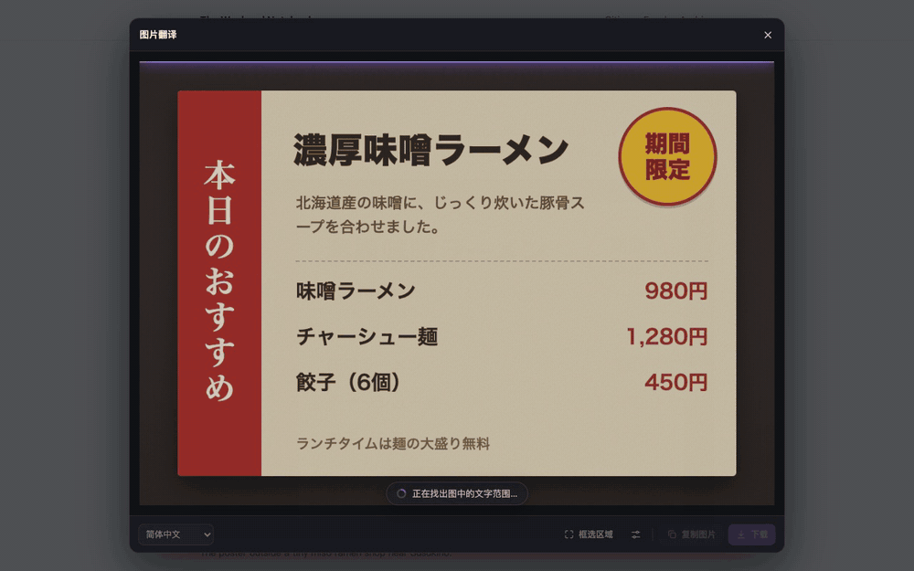
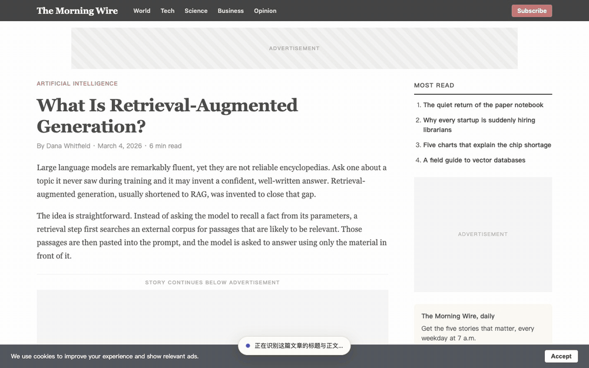
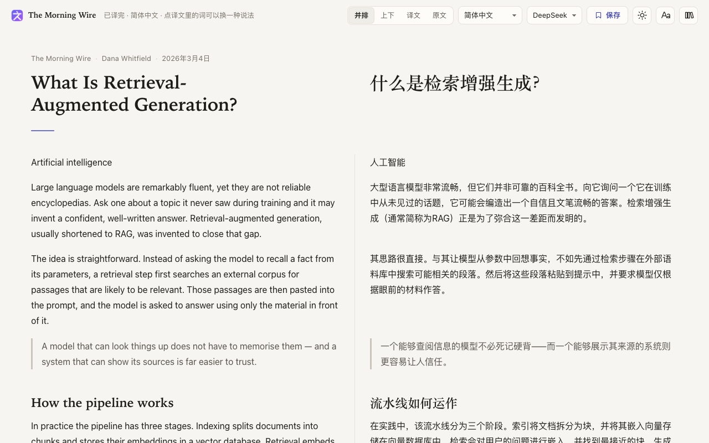
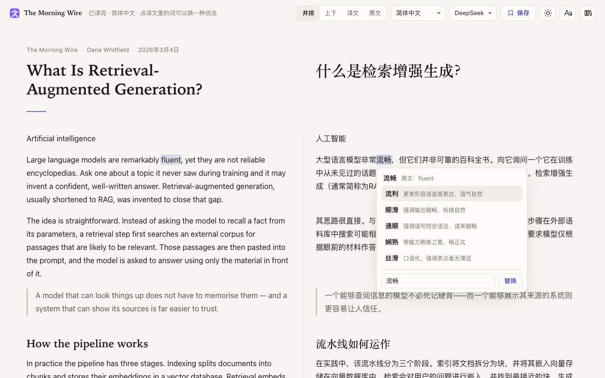
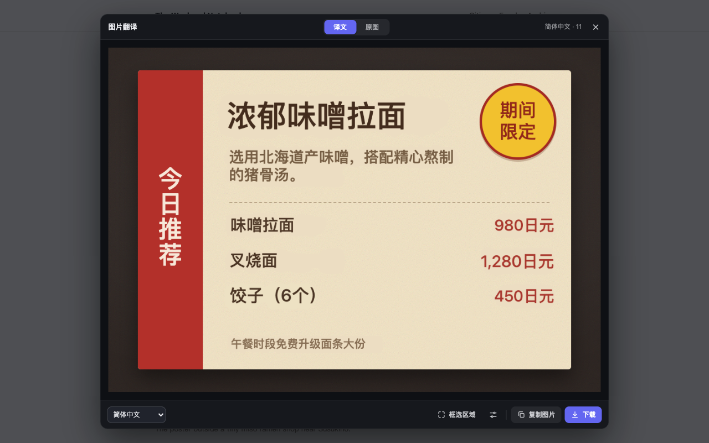
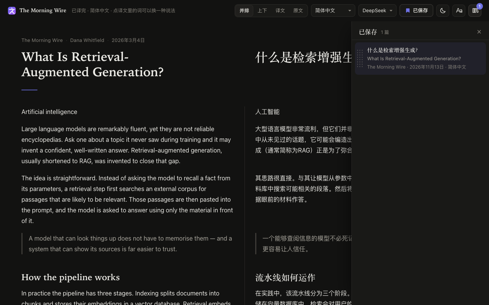
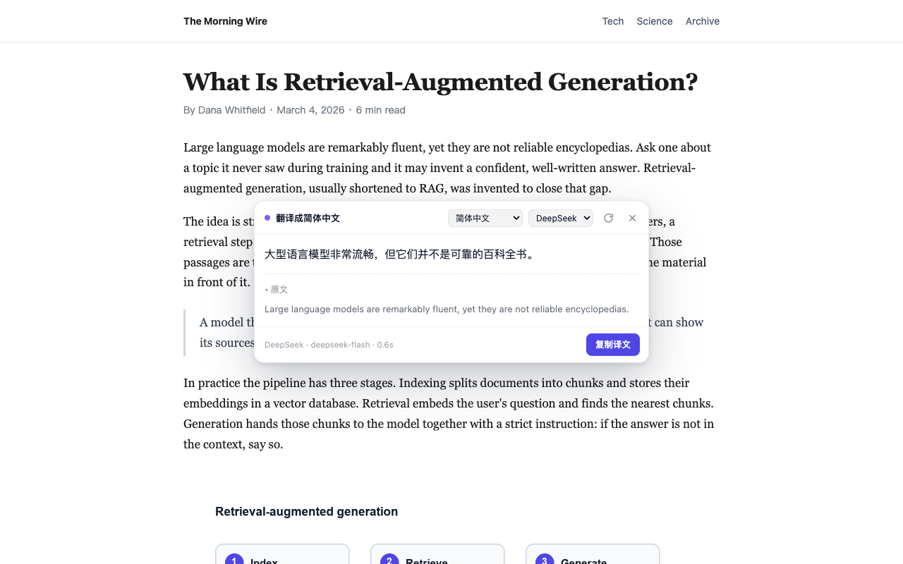
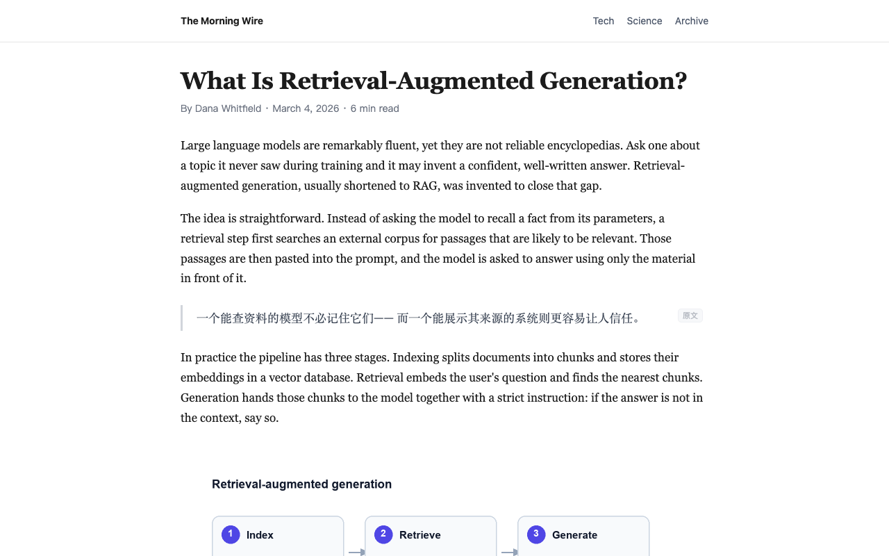
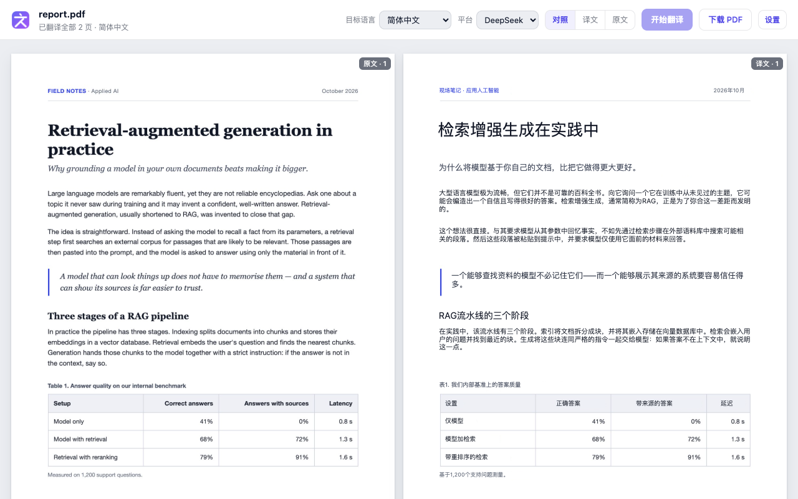
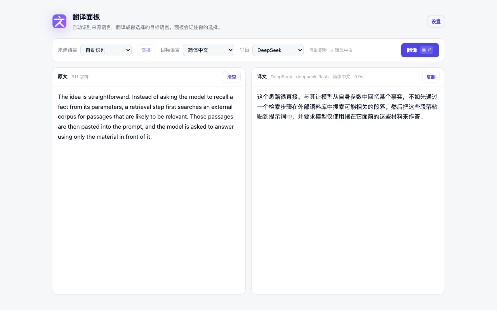

# Huaci · 划词

[English](../../README.md) · [简体中文](README.zh-CN.md) · [日本語](README.ja.md) · [Français](README.fr.md) · **Deutsch** · [Español](README.es.md) · [العربية](README.ar.md)

**Huaci — KI-Übersetzer und zweisprachiger Reader.** Früher „AI 划词翻译 / AI Translator“; seit 2.2.0 unter neuem Namen, mit denselben Erweiterungs-IDs und Store-Einträgen.

Lesen Sie fremdsprachige Artikel und übersetzen Sie Bilder und PDFs direkt im Browser. Original und Übersetzung stehen absatzweise nebeneinander. Klicken Sie auf ein übersetztes Wort, um eine andere Formulierung zu wählen, und speichern Sie Artikel mit Übersetzungen auf Ihrem Gerät. Huaci bietet außerdem die Übersetzung markierter Texte, einzelner Seitenbereiche und ein separates Übersetzungsfenster. Verwenden Sie Ihren eigenen API-Schlüssel oder die gehostete Übersetzung mit Guthaben ohne eigenen Schlüssel.

[Website](https://huaci.app/) · [Chrome Web Store](https://chromewebstore.google.com/detail/ai-translator/hogimafgjmlpdlnepojgigjkhaccbcbj) · [Edge-Add-ons](https://microsoftedge.microsoft.com/addons/detail/mojcgjimlkkbohomcijkmoefpeekmohe) · [Anleitung zur Erweiterung](../../apps/extension/README.md)

## Vorschau

Diese Screenshots und Aufnahmen zeigen die aktuelle **Entwicklungsversion 2.2.0**, geladen in Chrome. Erkennung und Übersetzung verwenden echte Modelle. Zweisprachiges Lesen, alternative Formulierungen und Bildübersetzungen entlang der Textformen werden für die Veröffentlichung vorbereitet. Angaben zur Store-Verfügbarkeit finden Sie in der [Anleitung zur Erweiterung](../../apps/extension/README.md#account-and-credits-hosted-mode).

**Bilderkennung und Übersetzung:** Text erkennen, Übersetzungen entlang der Textformen einblenden, mit dem Original vergleichen, einzelne Übersetzungen bearbeiten oder Bereiche manuell auswählen.



**Zweisprachiges Lesen:** Artikeltext extrahieren, Werbung entfernen und jeden Absatz neben seiner Übersetzung anzeigen. Alternative Formulierungen wählen, die Anordnung wechseln und Artikel samt Übersetzung auf dem Gerät speichern.



| Zweisprachiges Lesen | Alternative Formulierungen |
| --- | --- |
| [](../screenshots/01-bilingual-reader.png) | [](../screenshots/02-word-alternatives.png) |
| **Bildübersetzung** | **Dunkelmodus und gespeicherte Artikel** |
| [](../screenshots/04-image-translation.png) | [](../screenshots/03-reader-library.png) |
| **Markierten Text übersetzen** | **Seitenbereich übersetzen** |
| [](../screenshots/06-selection-translation.png) | [](../screenshots/09-region-translation.png) |
| **Gesamtes PDF im Vergleich** | **Übersetzungsfenster** |
| [](../screenshots/08-pdf-translation.png) | [](../screenshots/07-translation-panel.png) |

Die [Aufnahmehinweise](../screenshots/README.de.md) beschreiben die Aufnahmeumgebung und die verwendeten Beispiele. Die aufgenommene Oberfläche ist auf vereinfachtem Chinesisch; alle Sprachfassungen der Dokumentation verwenden dieselben Bilder und GIFs.

## Projekt

Ein Repository, drei Anwendungen: eine HTML-Website auf Vercel, ein Backend auf einem VPS und eine Browser-Erweiterung.

| Anwendung | Verzeichnis | Laufzeitumgebung | Stand |
| --- | --- | --- | --- |
| Website | [apps/web](../../apps/web/README.md) | Vercel | Produktseiten, Datenschutz, Nutzungsbedingungen und Änderungsprotokoll in 11 Sprachen; der Kopfbereich fragt den Anmeldestatus bei app.huaci.app ab |
| Backend | [apps/backend](../../apps/backend/README.md) | VPS | Authentifizierung, Benutzer- und Verwaltungsoberflächen, Erweiterungs-API, Gasttest, genaue Guthabenabrechnung, gehostete Text- und Bildübersetzung sowie Creem-Abonnements; erste Version bereitgestellt |
| Erweiterung | [apps/extension](../../apps/extension/README.md) | Chrome / Edge | Store-Version: 2.1.0. Quellcode: 2.2.0 mit zweisprachigem Lesen, alternativen Formulierungen, Wortwahlpräferenzen und Bildübersetzung entlang der Textformen; Veröffentlichung in Vorbereitung |

## Verzeichnisstruktur

```text
apps/
  web/
    public/          HTML, CSS, JS, Ressourcen und generierte Sprachseiten
    i18n/            Website-Übersetzungen und Seitengenerator
    test/            Website-, Sprachwechsel- und CSP-Prüfungen
  backend/
    src/             Hono: Konfiguration, Datenbank, Anmeldung, Guthaben, E-Mail
    ui/account/      Benutzeroberfläche mit serverseitigem Rendering
    migrations/      PostgreSQL-Migrationen
    test/  deploy/   Backend-Tests und Anleitung zur VPS-Bereitstellung
  extension/
    manifest.json    Manifest der Chrome-Erweiterung
    src/             Code und Oberfläche; src/vendor/pdfjs enthält unverändertes pdf.js
    icons/           Symbole der Erweiterung
    _locales/        Generierte Chrome-Lokalisierungsdateien
    i18n/            UI-Übersetzungen, Sprachverzeichnis und Vorlagen
    scripts/         Lokale Werkzeuge für Textextraktion, Übersetzung und Builds
    test/            Tests der Erweiterung
    store-assets/    Store-Texte, Screenshots und Werbematerial
    package.sh       Paketierungswerkzeug der Erweiterung
docs/                Architektur, technische Hinweise und mehrsprachige READMEs
test/run.sh          Einstiegspunkt für repositoryweite Tests
package.sh           Einstiegspunkt zur Paketierung der Erweiterung
vercel.json          Vercel-Bereitstellung und Sicherheitsheader
dist/extension/      Generierte Erweiterungs-ZIPs, nicht versioniert
tools/               Lokale Aufnahme- und Versuchswerkzeuge, nicht versioniert
LICENSE              Lizenz des Repositorys
PRIVACY.md           Beibehaltener öffentlicher Pfad der Datenschutzerklärung
```

## Lokale Entwicklung

Die Entwicklungswerkzeuge benötigen Node.js 22 oder neuer. Für die Website-Vorschau und die Paketierung der Erweiterung wird außerdem Python 3 benötigt. Die Erweiterung selbst setzt Chrome 116 oder neuer voraus. Builds und Tests von Website und Erweiterung verwenden Standardbibliotheken ohne npm-Abhängigkeiten. Das Backend hat eigene Abhängigkeiten (`cd apps/backend && npm ci`) und benötigt lokales PostgreSQL. Sind diese Abhängigkeiten nicht installiert, überspringt `npm test` das Backend.

```sh
npm run dev                   # Lokale Dienste starten; Strg+C beendet sie gemeinsam
npm test                      # Website und Erweiterung testen
npm run test:web              # Nur Website testen
npm run test:extension        # Nur Erweiterung testen
npm run dev:web               # http://localhost:8788
npm run build:web             # Sprachseiten der Website generieren
npm run check:web             # Generierte Website-Übersetzungen prüfen
npm run i18n:extension        # UI-Übersetzungen der Erweiterung lokal aktualisieren
npm run check:extension       # Generierte Übersetzungen der Erweiterung prüfen
npm run package:extension     # dist/extension/ai-translation-<version>.zip
npm run package:edge          # dist/extension/ai-translation-edge-<version>.zip
npm run test:backend          # Benötigt die PostgreSQL-Datenbank huaci_test
npm run migrate:backend       # Datenbankmigrationen des Backends ausführen
npm run dev:backend           # http://localhost:8787 — Benutzeroberfläche
```

`npm run dev` startet:

| Dienst | Adresse |
| --- | --- |
| Backend: Benutzeroberfläche, Erweiterungs-API und Creem-Callbacks; ausstehende Migrationen laufen vor dem Start | `http://localhost:8787` |
| Verwaltungsoberfläche: gleicher Backend-Prozess, Auswahl anhand des Hostnamens | `http://admin.localhost:8787` |
| Website-Vorschau | `http://localhost:8788` |
| Überwachung der UI-Übersetzungen; dieses Verzeichnis entpackt in Chrome laden | `apps/extension` |

Dienste mit bereits belegten Ports werden mit einer Erklärung übersprungen. Führen Sie vor dem Start des Backends `npm ci` in `apps/backend` aus und richten Sie lokales PostgreSQL sowie `apps/backend/.env.local` ein.

Die bisherigen Einstiegspunkte `bash test/run.sh` und `bash package.sh` funktionieren weiterhin im Stammverzeichnis. Die Skripte der einzelnen Anwendungen können auch aus deren Verzeichnissen ausgeführt werden.

Wählen Sie im Chrome-Entwicklermodus bei **Entpackte Erweiterung laden** das Verzeichnis **`apps/extension`**, nicht das Stammverzeichnis des Repositorys. Ein geänderter Ladepfad kann der Entwicklungsversion eine neue ID geben und eine erneute Einrichtung erfordern. Store-Updates verwenden weiterhin denselben Eintrag.

Der Generator für UI-Übersetzungen liest zuerst `apps/extension/.env.local` und verwendet andernfalls `.env.local` im Stammverzeichnis. Auch Prozessumgebungsvariablen werden unterstützt. Bereits vorhandene Schlüssel im Stammverzeichnis müssen nicht verschoben werden. Zur Laufzeit verwendete API-Schlüssel liegen ausschließlich in `chrome.storage.local`. Umgebungsdateien und Entwicklungswerkzeuge zur Übersetzung sind nicht Teil der Erweiterungspakete.

## Bereitstellung

- **Vercel-Website:** Das Stammverzeichnis des Repositorys bleibt das Vercel-Projektverzeichnis. `vercel.json` baut `apps/web` und veröffentlicht nur `apps/web/public`. Der GitHub-Workflow läuft bei Änderungen an Website, Vercel-Konfiguration oder zugehörigen Build-Einstiegspunkten.

- **VPS-Backend:** `apps/backend` wird unabhängig bereitgestellt; der Kontodienst ist unter `app.huaci.app` erreichbar. Gehostete Audio-/Videotranskription ist nicht implementiert. Bereits erkannte Untertitel können die gehostete Textübersetzung verwenden. Siehe [Bereitstellungsanleitung](../../apps/backend/deploy/README.md).

- **Browser-Erweiterung:** Die Pakete werden separat erstellt und in den Stores veröffentlicht. ZIP-Dateien enthalten ausschließlich `manifest.json`, `src/`, `icons/`, `_locales/` und die Datei `LICENSE` aus dem Stammverzeichnis.

Die [Architekturdokumentation](../architecture.md) beschreibt Zuständigkeiten, frühere Verzeichnispfade und Entwicklungsprioritäten. Die Entwicklungsregeln des Repositorys stehen in [AGENTS.md](../../AGENTS.md).

[Website](https://huaci.app/) · [Quellcode](https://github.com/csswork/AiTranslation)

Veröffentlicht unter [GPL-3.0](../../LICENSE).
