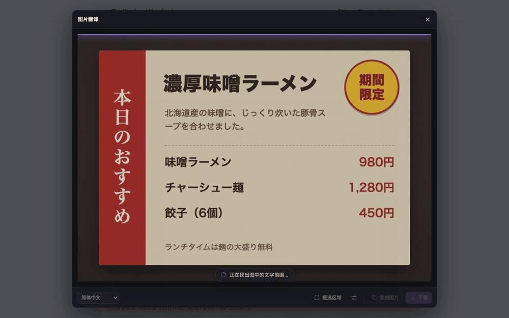
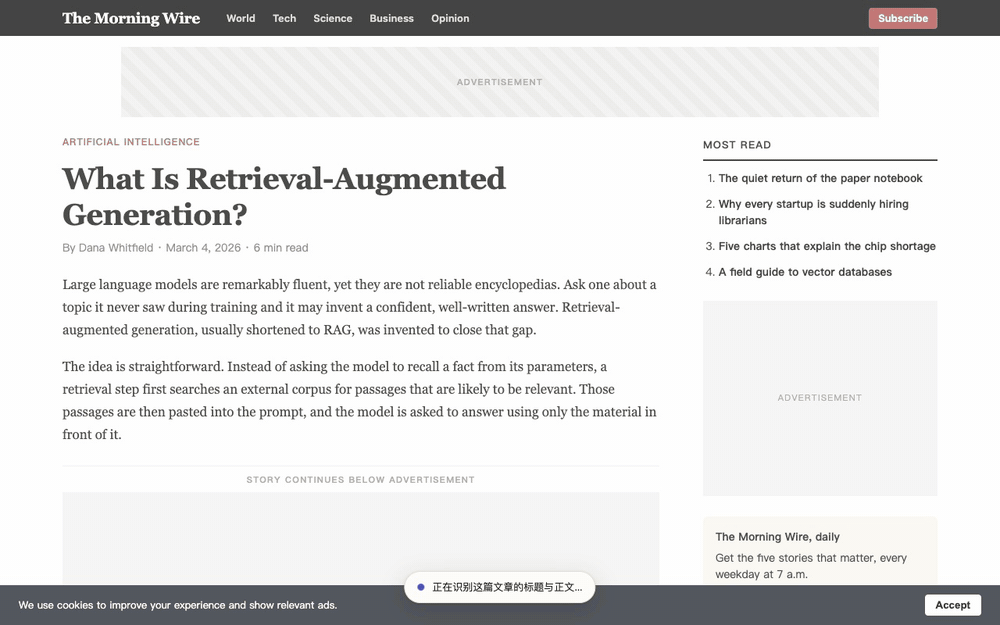
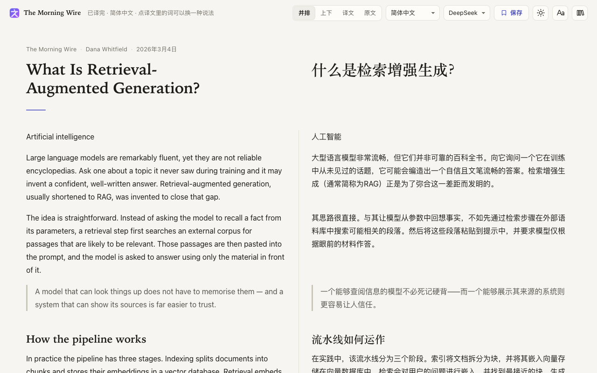
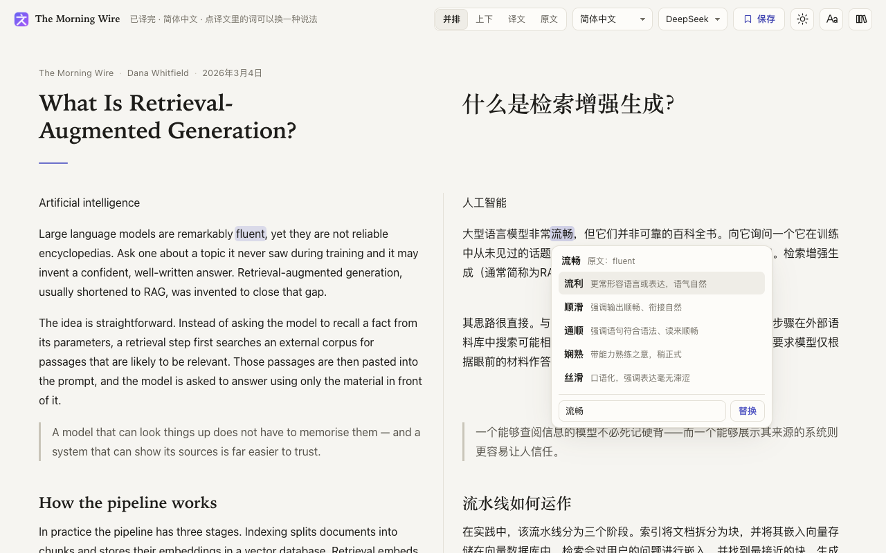
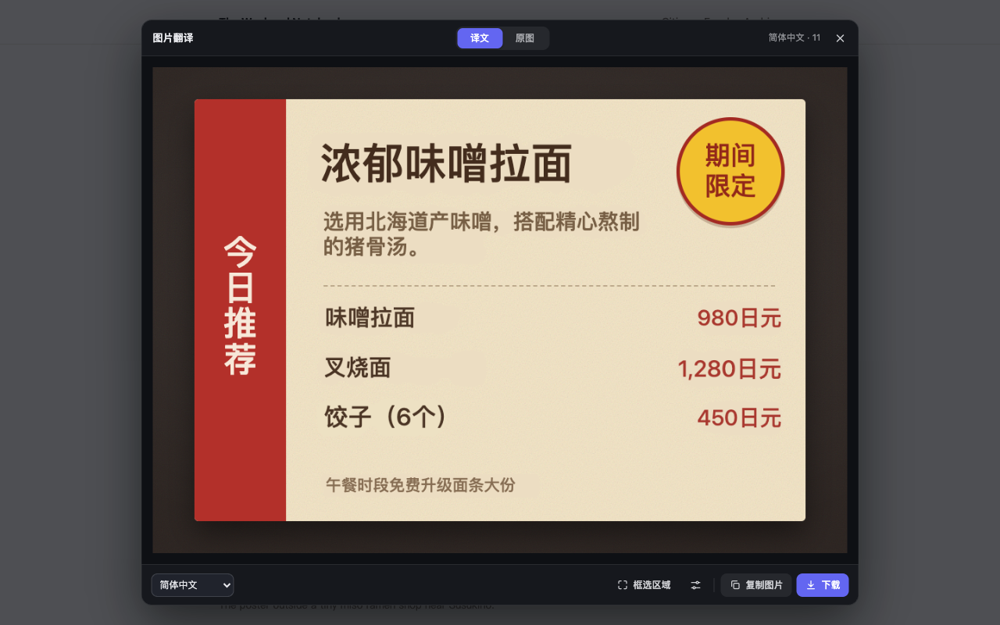
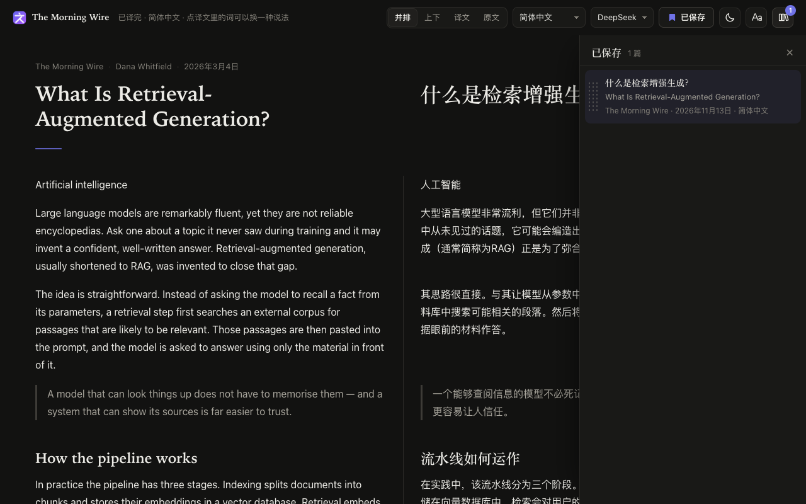
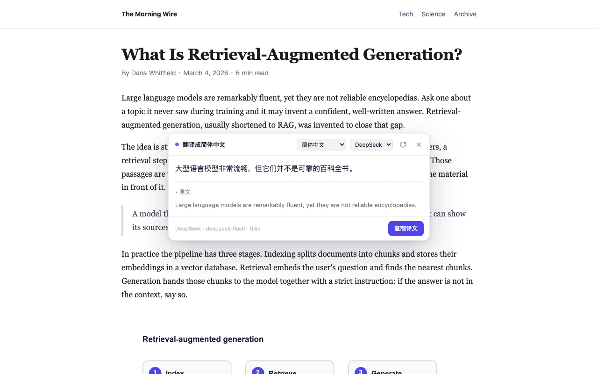
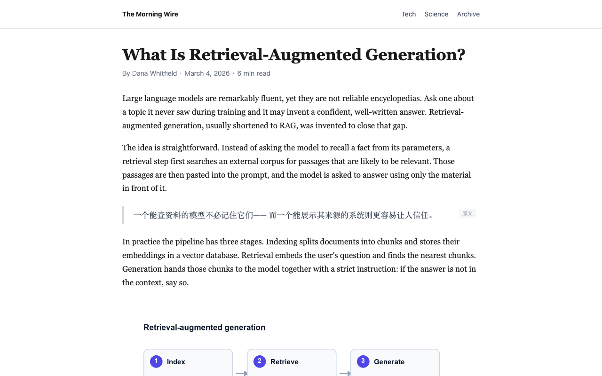
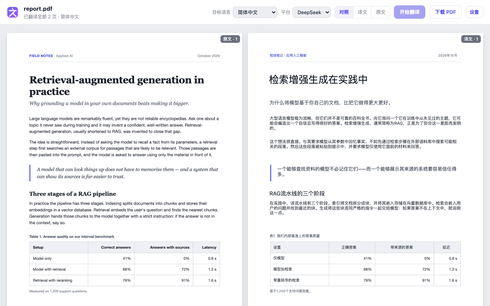
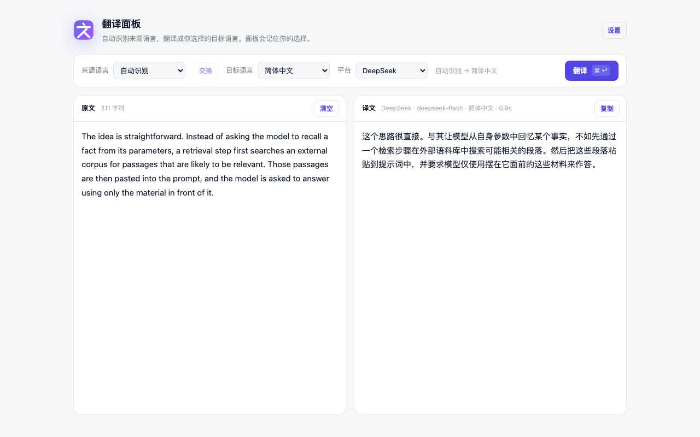

# Huaci · 划词

[English](../../README.md) · [简体中文](README.zh-CN.md) · [日本語](README.ja.md) · [Français](README.fr.md) · [Deutsch](README.de.md) · **Español** · [العربية](README.ar.md)

**Huaci — Traductor con IA y lector bilingüe.** Antes se llamaba «AI 划词翻译 / AI Translator»; cambió de nombre en la versión 2.2.0 y conserva los mismos identificadores de extensión y fichas en las tiendas.

Lee artículos en otros idiomas y traduce imágenes y PDF directamente en el navegador. Mantén alineados los párrafos originales y traducidos, pulsa una palabra traducida para elegir otra expresión y guarda los artículos con sus traducciones en tu dispositivo. Huaci también permite traducir texto seleccionado, zonas de una página y usar un panel de traducción independiente. Puedes usar tu propia clave API o la traducción alojada con créditos, sin clave propia.

[Sitio web](https://huaci.app/) · [Chrome Web Store](https://chromewebstore.google.com/detail/ai-translator/hogimafgjmlpdlnepojgigjkhaccbcbj) · [Complementos de Edge](https://microsoftedge.microsoft.com/addons/detail/mojcgjimlkkbohomcijkmoefpeekmohe) · [Complementos de Firefox](https://addons.mozilla.org/firefox/addon/huaci-ai-translator/) · [Guía de la extensión](../../apps/extension/README.md)

## Novedades de la versión 2.4.0

Publicada el **2026-11-23** y disponible en Chrome Web Store, Microsoft Edge Add-ons y Firefox Add-ons. Consulta el [registro de cambios](https://huaci.app/es/changelog.html#v2-4-0) y las [notas de la versión](../extension/releases/2.4.0.md).

- **Caché local de traducciones**: las traducciones hechas con tu propia clave API (ChatGPT, DeepSeek y otros modelos) y con DeepL se cifran y se guardan en tu dispositivo. El texto repetido se muestra desde la caché sin una nueva solicitud, ahorrando tokens y cuota de caracteres. Funciona con texto seleccionado, zonas de página, sitios, lectura bilingüe, PDF completos, imágenes y expresiones alternativas; la traducción de zonas y sitios muestra primero los párrafos en caché. Al cambiar de idioma, modelo, estilo o preferencias de vocabulario se vuelve a traducir, y **Volver a traducir** omite la caché. Desde Ajustes puedes desactivarla, ver cuántas entradas hay y vaciarla. La traducción con créditos y la traducción local no usan esta caché.
- **Estilo de traducción**: las guías de estilo incorporan ejemplos para una expresión, terminología y tono más uniformes.
- **Ya disponible en Firefox**: instálala desde [Firefox Add-ons](https://addons.mozilla.org/firefox/addon/huaci-ai-translator/) (Firefox de escritorio 142 o posterior). La cuenta, los créditos y la suscripción se comparten con las versiones de Chrome y Edge. Firefox no ofrece traducción local ni subtítulos de vídeo; los PDF completos se abren desde la ventana emergente de la barra de herramientas.

## Vista previa

Estas capturas y grabaciones se realizaron el **2026-11-13** con una **versión 2.2.0 cargada desde el código fuente** en Chrome y modelos reales para el reconocimiento y la traducción. Muestran la lectura bilingüe, las expresiones alternativas y la traducción de imágenes. Las novedades se describen arriba; consulta la [guía de la extensión](../../apps/extension/README.md#account-and-credits-hosted-mode) para conocer la disponibilidad en las tiendas.

**Reconocimiento y traducción de imágenes:** Detecta el texto, superpone la traducción siguiendo su forma, compara con el original, edita traducciones individuales o selecciona zonas manualmente.



**Lectura bilingüe:** Extrae el cuerpo del artículo, elimina los anuncios y alinea cada párrafo con su traducción. Elige otras expresiones, cambia la disposición y guarda el artículo con su traducción en tu dispositivo.



| Lectura bilingüe | Expresiones alternativas |
| --- | --- |
| [](../screenshots/01-bilingual-reader.png) | [](../screenshots/02-word-alternatives.png) |
| **Traducción de imágenes** | **Modo oscuro y artículos guardados** |
| [](../screenshots/04-image-translation.png) | [](../screenshots/03-reader-library.png) |
| **Traducción del texto seleccionado** | **Traducción de zonas de página** |
| [](../screenshots/06-selection-translation.png) | [](../screenshots/09-region-translation.png) |
| **Traducción de PDF completos en paralelo** | **Panel de traducción** |
| [](../screenshots/08-pdf-translation.png) | [](../screenshots/07-translation-panel.png) |

Consulta las [notas de captura](../screenshots/README.es.md) para ver el entorno de grabación y los materiales de ejemplo. La interfaz capturada está en chino simplificado; todos los idiomas de la documentación comparten estas imágenes y GIF.

## Proyecto

Un repositorio, tres aplicaciones: un sitio HTML en Vercel, un backend en un VPS y una extensión de navegador.

| Aplicación | Directorio | Entorno | Estado |
| --- | --- | --- | --- |
| Sitio web | [apps/web](../../apps/web/README.md) | Vercel | Presentación, privacidad, condiciones e historial de cambios en 11 idiomas; la cabecera consulta el estado de sesión en app.huaci.app |
| Backend | [apps/backend](../../apps/backend/README.md) | VPS | Autenticación, interfaces de usuario y administración, API de la extensión, prueba para visitantes, contabilidad precisa de créditos, traducción alojada de texto e imágenes y suscripciones con Creem; primera versión desplegada |
| Extensión | [apps/extension](../../apps/extension/README.md) | Chrome / Edge / Firefox | 2.4.0 disponible en las tiendas de Chrome, Edge y Firefox. [Notas de la versión](../extension/releases/2.4.0.md) |

## Estructura

```text
apps/
  web/
    public/          HTML, CSS, JS, recursos y páginas de idiomas generadas
    i18n/            Traducciones del sitio y generador de páginas
    test/            Pruebas del sitio, cambio de idioma y CSP
  backend/
    src/             Hono: configuración, base de datos, autenticación, créditos, correo
    ui/account/      Interfaz de usuario renderizada en el servidor
    migrations/      Migraciones de PostgreSQL
    test/  deploy/   Pruebas del backend e instrucciones de despliegue en VPS
  extension/
    manifest.json    Manifiesto de la extensión de Chrome
    src/             Código e interfaz; src/vendor/pdfjs contiene pdf.js sin modificar
    icons/           Iconos de la extensión
    _locales/        Archivos de localización de Chrome generados
    i18n/            Traducciones de interfaz, registro de idiomas y plantillas
    scripts/         Herramientas locales de extracción, traducción y compilación
    test/            Pruebas de la extensión
    store-assets/    Fichas de las tiendas, capturas y material promocional
    package.sh       Herramienta de empaquetado de la extensión
docs/                Arquitectura, notas técnicas y README multilingües
test/run.sh          Punto de entrada de las pruebas del repositorio
package.sh           Punto de entrada del empaquetado de la extensión
vercel.json          Despliegue de Vercel y cabeceras de seguridad
dist/extension/      ZIP generados de la extensión, no versionados
tools/               Herramientas locales de captura y experimentación, no versionadas
LICENSE              Licencia del repositorio
PRIVACY.md           Ruta pública histórica de la política de privacidad
```

## Desarrollo local

Las herramientas de desarrollo requieren Node.js 22 o posterior. La vista previa del sitio y el empaquetado de la extensión también requieren Python 3. La extensión necesita Chrome 128 o posterior. Las compilaciones y pruebas del sitio y la extensión usan bibliotecas estándar, sin dependencias npm. El backend tiene sus propias dependencias (`cd apps/backend && npm ci`) y requiere PostgreSQL local. `npm test` omite el backend si no están instaladas sus dependencias.

```sh
npm run dev                   # Iniciar los servicios locales; Ctrl+C los detiene juntos
npm test                      # Pruebas del sitio y de la extensión
npm run test:web              # Solo pruebas del sitio
npm run test:extension        # Solo pruebas de la extensión
npm run dev:web               # http://localhost:8788
npm run build:web             # Generar las páginas de idiomas del sitio
npm run check:web             # Comprobar las traducciones generadas del sitio
npm run i18n:extension        # Actualizar localmente las traducciones de la extensión
npm run check:extension       # Comprobar las traducciones generadas de la extensión
npm run package:extension     # dist/extension/ai-translation-<version>.zip
npm run package:edge          # dist/extension/ai-translation-edge-<version>.zip
npm run test:backend          # Requiere la base de datos PostgreSQL huaci_test
npm run migrate:backend       # Aplicar las migraciones de la base de datos del backend
npm run dev:backend           # http://localhost:8787 — interfaz de usuario
```

`npm run dev` inicia:

| Servicio | Dirección |
| --- | --- |
| Backend: interfaz de usuario, API de la extensión y callbacks de Creem; aplica las migraciones pendientes antes de arrancar | `http://localhost:8787` |
| Interfaz de administración: mismo proceso backend, según el nombre de host | `http://admin.localhost:8787` |
| Vista previa del sitio | `http://localhost:8788` |
| Supervisión de las traducciones de interfaz; cargar este directorio sin empaquetar en Chrome | `apps/extension` |

Los servicios cuyos puertos ya estén ocupados se omiten con una explicación. Antes de iniciar el backend, ejecuta `npm ci` en `apps/backend` y configura PostgreSQL local y `apps/backend/.env.local`.

Los puntos de entrada de compatibilidad `bash test/run.sh` y `bash package.sh` siguen funcionando desde la raíz del repositorio. Los scripts de cada aplicación también se pueden ejecutar desde su propio directorio.

En el modo de desarrollador de Chrome, **Cargar descomprimida** debe apuntar a **`apps/extension`**, no a la raíz del repositorio. Si cambias la ruta de la extensión de desarrollo, puede recibir un nuevo identificador y requerir una nueva configuración. Las actualizaciones de las tiendas conservan la misma ficha.

El generador de traducciones de la interfaz lee primero `apps/extension/.env.local`; si no existe, usa `.env.local` en la raíz. También admite variables de entorno del proceso. Las claves existentes en el archivo raíz pueden permanecer allí. Las claves API de ejecución solo se guardan en `chrome.storage.local`. Los archivos de entorno y las herramientas de traducción de desarrollo quedan fuera de los paquetes.

## Despliegue

- **Sitio en Vercel:** Mantén la raíz del repositorio como raíz del proyecto de Vercel. `vercel.json` compila `apps/web` y publica únicamente `apps/web/public`. El flujo de GitHub se ejecuta cuando cambian el sitio, la configuración de Vercel o los puntos de entrada de compilación relacionados.

- **Backend en VPS:** `apps/backend` se despliega de forma independiente; el servicio de cuentas está disponible en `app.huaci.app`. La transcripción alojada de audio y vídeo no está implementada. Los subtítulos ya reconocidos pueden usar la traducción alojada de texto. Consulta las [instrucciones de despliegue](../../apps/backend/deploy/README.md).

- **Extensión de navegador:** Se empaqueta y publica por separado en las tiendas. Los ZIP solo contienen `manifest.json`, `src/`, `icons/`, `_locales/` y el archivo `LICENSE` de la raíz.

Consulta la [documentación de arquitectura](../architecture.md) para conocer las responsabilidades, la correspondencia con los directorios antiguos y las prioridades de desarrollo. Las normas de desarrollo del repositorio están en [AGENTS.md](../../AGENTS.md).

[Sitio web](https://huaci.app/) · [Código fuente](https://github.com/csswork/AiTranslation)

Publicado bajo [GPL-3.0](../../LICENSE).
